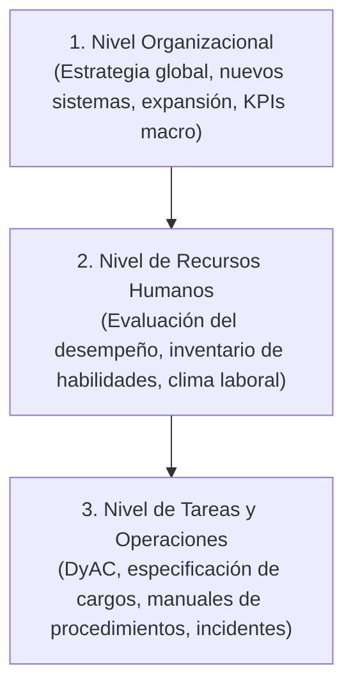
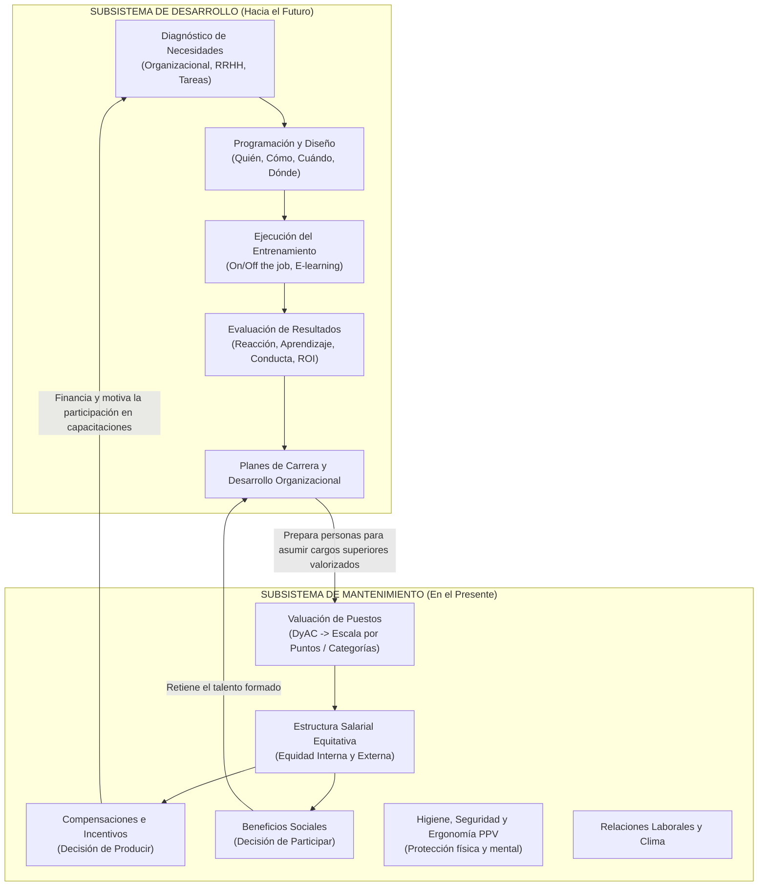

# RESOLUCIÓN OFICIAL: Cuestionario de Estudio - Subsistema de Desarrollo y Mantenimiento de RRHH
**Universidad Tecnológica Nacional - Facultad Regional Resistencia**  
**Ingeniería en Sistemas de Información | Administración de Sistemas de Información (4° Nivel)**  
**Ciclo Lectivo: 2026**  
**Docentes:** Ing. Claudia A. Soria Ojeda (Responsable), Ing. Rosina A. Ramírez (JTP), Ing. Raúl A. Montiel (Auxiliar).

---

# PARTE I: Subsistema de Desarrollo de Recursos Humanos
*Bibliografía de Referencia: Idalberto Chiavenato (2005) "Administración de Recursos Humanos" (5ta Ed., McGraw-Hill, Cap. 11/14).*

---

### 1. ¿Qué procesos incluye el subsistema de desarrollo?
El **Subsistema de Desarrollo de Recursos Humanos** abarca todos los procesos orientados a la formación, crecimiento profesional y evolución integral de las personas dentro de la organización. Incluye:
1. **Entrenamiento y Capacitación del Personal (Training):** Proceso de corto plazo enfocado en impartir y perfeccionar conocimientos, destrezas técnicas y habilidades operativas requeridas para el desempeño eficiente del cargo actual.
2. **Desarrollo de Personas (Development):** Proceso de mediano y largo plazo orientado a desarrollar competencias conceptuales, de liderazgo y actitudinales para preparar a los colaboradores ante futuras promociones y roles de mayor complejidad estratégica.
3. **Planes de Carrera (Career Planning):** Estructuración de rutas de progresión y crecimiento dentro de la organización alineando los intereses individuales del empleado con las necesidades organizacionales futuras.
4. **Desarrollo Organizacional (DO):** Proceso sistemático y planificado de cambio cultural y estructural en toda la organización para mejorar su adaptabilidad, clima y efectividad global ante transformaciones del entorno.

---

### 2. Objetivos del desarrollo de RH
Los objetivos primordiales del desarrollo de RRHH según Chiavenato son:
* **Adaptación al Puesto:** Preparar al personal para la ejecución inmediata de las diversas tareas y responsabilidades del cargo asignado.
* **Crecimiento Profesional:** Proporcionar oportunidades para el continuo desarrollo personal y profesional, tanto en el cargo actual como en otros puestos de nivel superior.
* **Cambio de Actitud y Cultura:** Modificar la actitud de las personas para crear un clima laboral más satisfactorio, receptivo a la innovación, al trabajo en equipo y al compromiso con la calidad.
* **Cierre de Brechas Tecnológicas:** Actualizar permanentemente las competencias del personal frente a la rápida obsolescencia de herramientas de software, metodologías y arquitecturas de SI/TI.
* **Aumento de la Productividad y Reducción de Costos:** Minimizar errores, retrabajos, accidentes laborales y la necesidad de supervisión directa.

---

### 3. ¿Cuál es el resultado de estos procesos? (Elaboración y Conclusiones)
El resultado directo e indirecto de los procesos de desarrollo se traduce en:
* **Incremento del Capital Intelectual y Humano:** La organización amplía su masa crítica de conocimiento experto, innovación y capacidad de resolución de problemas complejos.
* **Mayor Flexibilidad y Adaptabilidad:** Equipos polivalentes capaces de absorber nuevas tecnologías (ej. Cloud Computing, DevSecOps, IA) con menor resistencia al cambio.
* **Reducción del Turnover (Rotación) y Aumento del Engagement:** Los profesionales de IT valoran la capacitación continua y las rutas de carrera claras, lo que reduce la fuga de talento hacia la competencia.
* **Mayor Autonomía y Eficiencia Operativa:** Disminución de incidentes en producción, mejora en los tiempos de entrega de proyectos y elevación de la calidad del software.

---

### 4. Aprendizaje
#### a. Concepto:
El **aprendizaje** es un cambio relativamente permanente en la conducta o en el potencial de conducta de un individuo, que ocurre como resultado directo de la experiencia, el entrenamiento, la práctica o la interacción con el entorno. No es una simple asimilación pasiva de información, sino una transformación cognitiva y conductual observable.

#### b. Leyes del Aprendizaje (Leyes de Thorndike y Psicología Educativa aplicada a las Organizaciones):
* **Ley del Efecto:** Las conductas seguidas de consecuencias satisfactorias (recompensas, reconocimiento, éxito) tienden a repetirse y fijarse; las seguidas de consecuencias desagradables o castigos tienden a extinguirse.
* **Ley del Ejercicio / Uso y Desuso:** Cuanto más frecuentemente se practica y aplica una destreza aprendida, más se consolida la conexión neuronal y el dominio del conocimiento. La falta de práctica conduce al olvido y la pérdida de destreza.
* **Ley de la Disposición / Preparación:** El aprendizaje es sumamente eficaz cuando el individuo está motivado, receptivo y posee los conocimientos previos necesarios para asimilar el nuevo contenido.
* **Ley de la Primacía y de la Recencia:** Lo aprendido en primer lugar crea una impresión duradera y fundacional (primacía), mientras que lo practicado más recientemente se recuerda con mayor facilidad y precisión (recencia).
* **Ley de la Intensidad:** Una experiencia de aprendizaje vívida, práctica, inmersiva y emocionante (ej. simulaciones en laboratorios reales) genera un impacto mayor y más duradero que una clase teórica abstracta.

---

### 5. Entrenamiento
#### a. Concepto:
El **entrenamiento** es un proceso educativo sistemático y organizado a corto plazo, mediante el cual las personas aprenden conocimientos, aptitudes y habilidades en función de objetivos predeterminados para la ejecución eficaz de sus tareas laborales.

#### b. Las Cuatro Etapas del Proceso de Entrenamiento:
1. **1. Diagnóstico / Inventario de Necesidades de Entrenamiento:** Detección y relevamiento formal de las carencias y brechas de conocimiento que deben ser subsanadas.
2. **2. Programación del Entrenamiento:** Diseño pedagógico y logístico del plan de capacitación (a quién entrenar, cómo entrenar, en qué tema, quién será el instructor, cuándo, dónde y con qué presupuesto).
3. **3. Ejecución del Entrenamiento:** Conducción e impartición real de las actividades pedagógicas mediante la interacción entre instructor y aprendices.
4. **4. Evaluación de los Resultados:** Verificación empírica del impacto y efectividad del programa a nivel de reacción, aprendizaje, conducta en el puesto y retorno de inversión organizacional (ROI).

---

### 6. Inventario de Necesidades: Medios para relevar las necesidades de capacitación
El relevamiento o inventario de necesidades de entrenamiento se realiza mediante un análisis en **tres niveles concéntricos**:

#### Medios e Instrumentos Técnicos de Relevamiento:
* **Evaluación del Desempeño:** Identifica empleados con rendimientos por debajo del estándar esperado.
* **Observación Directa en el Puesto de Trabajo:** El supervisor detecta ineficiencias o errores en la ejecución técnica de tareas.
* **Cuestionarios y Encuestas de Detección de Necesidades:** Preguntas dirigidas a empleados y líderes sobre áreas de interés y vacíos técnicos.
* **Solicitudes Directas de Gerentes y Supervisores:** Pedidos formales de capacitación ante la incorporación de nuevo software o infraestructura.
* **Entrevistas con Jefes de Área:** Diálogo estructurado sobre problemas recurrentes y proyectos futuros.
* **Revisión de la Descripción y Análisis de Cargos (DyAC):** Comparación entre los requisitos exigidos por el cargo y el perfil real del ocupante.
* **Análisis de Incidentes Críticos e Informes Periódicos:** Registro de fallas graves, bugs recurrentes, caídas de servidores o quejas de clientes.

---

### 7. Programación: Planeación y Tipos de Técnicas
#### a. Planeación (Los 7 Interrogantes de la Programación según Chiavenato):
1. **¿A quién entrenar?** (Población objetivo / aprendices).
2. **¿Quién debe entrenar?** (Instructor interno, consultor externo, líder técnico).
3. **¿Sobre qué entrenar?** (Contenido temático y programa de estudio).
4. **¿Dónde entrenar?** (En el puesto de trabajo, aula presencial, laboratorio virtual, plataforma e-learning).
5. **¿Cómo entrenar?** (Métodos pedagógicos, recursos audiovisuales, talleres prácticos).
6. **¿Cuándo entrenar?** (Cronograma, horario laboral, frecuencia de clases).
7. **¿Para qué entrenar?** (Objetivos de aprendizaje y resultados esperados).

#### b. Tipos de Técnicas de Entrenamiento:
* **En cuanto al Uso o Lugar de Aplicación:**
  * *Técnicas en el Puesto de Trabajo (On-the-job Training):* Instrucción directa del supervisor, coaching, rotación de puestos, asignación especial de proyectos.
  * *Técnicas Fuera del Puesto de Trabajo (Off-the-job Training):* Cursos presenciales en aula, seminarios externos, e-learning, simulación en entornos de prueba (sandbox).
* **En cuanto al Tiempo:**
  * *Entrenamiento de Inducción o Integración:* Previo al inicio de funciones para familiarizar al nuevo empleado con la cultura y normas de la empresa.
  * *Entrenamiento Continuo o en Servicio:* Impartido durante la permanencia en la empresa para actualizar conocimientos.
* **En cuanto a la Forma o Metodología Pedagógica:**
  * *Técnicas Orientadas al Contenido:* Clases magistrales, lecturas guiadas, webinars.
  * *Técnicas Orientadas al Proceso:* Dinámicas de grupo, role-playing, dramatizaciones para habilidades blandas.
  * *Técnicas Mixtas:* Estudios de caso, talleres prácticos (workshops), método de proyectos.

---

### 8. Desarrollo Organizacional (DO): Concepto Propio y Definiciones
* **Definición Clásica (Bennis, Beckhard):** El DO es una respuesta al cambio, una estrategia educacional planificada y compleja que abarca a toda la organización, administrada desde la alta dirección, para incrementar la efectividad y la salud de la empresa mediante intervenciones deliberadas en sus procesos organizacionales utilizando el conocimiento de las ciencias de la conducta.
* **Concepto Propio para Ingeniería en SI/TI:** *El Desarrollo Organizacional es el proceso sistemático, colaborativo y planificado mediante el cual una empresa tecnológica transforma su cultura, arquitectura de trabajo, flujos de comunicación y modelos de liderazgo para superar resistencias al cambio, adaptarse ágilmente a la disrupción tecnológica del mercado y maximizar de forma sostenible la innovación y el compromiso de sus equipos multidisciplinarios.*

---
---

# PARTE II: Subsistema de Mantenimiento de Recursos Humanos
*Bibliografía: Idalberto Chiavenato (2005) "Administración de Recursos Humanos" (5ta Ed., Cap. 10, 11, 12) y Material Complementario de Cátedra.*

---

### 1. ¿Qué incluye el subsistema de mantenimiento? Sintetizar cada concepto.
El **Subsistema de Mantenimiento de RRHH** comprende las condiciones ambientales, psicológicas, económicas y contractuales necesarias para retener al personal calificado en la organización y mantener un clima laboral motivador y seguro. Incluye:
1. **Administración de Sueldos y Salarios (Compensaciones):** Estructura técnica y equilibrada de retribuciones económicas para premiar la contribución de los empleados asegurando equidad interna y competitividad externa.
2. **Planes de Beneficios y Servicios Sociales:** Paquete de prestaciones indirectas (seguros médicos, comedor, guardería, flexibilidad horaria) para satisfacer necesidades sociales y de calidad de vida.
3. **Higiene y Seguridad Laboral:** Normas técnicas y condiciones ambientales (ergonomía, iluminación, prevención de accidentes y enfermedades profesionales) para proteger la salud física y mental del trabajador.
4. **Relaciones Laborales y Sindicales:** Gestión de los vínculos colectivos de trabajo, convenios, negociación colectiva y administración de conflictos.

---

### 2. ¿Qué debe equilibrar un plan de carreras? Describir las etapas para su elaboración.
#### a. Qué debe equilibrar:
Un **Plan de Carrera** debe equilibrar armónicamente dos fuerzas:
* **Las aspiraciones, expectativas personales y potencial de crecimiento del colaborador** (interés individual).
* **Las necesidades estratégicas futuras, vacantes críticas y objetivos de crecimiento de la empresa** (interés organizacional).

#### b. Etapas para la Elaboración de un Plan de Carrera:
1. **Autoevaluación del Empleado y Mapeo de Competencias:** Diagnóstico de los intereses, fortalezas, debilidades y valores del colaborador (mediante cuestionarios de carrera como Personio).
2. **Evaluación Organizacional del Potencial:** Valoración del desempeño histórico y proyección de capacidad para asumir mayores responsabilidades (comités de talento y matrices 9-Box).
3. **Identificación de Oportunidades y Rutas de Progresión (Carreer Paths):** Publicación y diseño transparente de las escalas de cargos jerárquicos y técnicos (ej. Junior $	o$ Semi-Senior $	o$ Senior $	o$ Tech Lead / Arquitecto).
4. **Acuerdo y Establecimiento de Objetivos de Carrera:** Fijación consensuada de metas a corto, mediano y largo plazo entre el líder y el colaborador.
5. **Diseño y Ejecución del Plan de Desarrollo Individual (PDI):** Asignación de programas específicos de formación, mentoría, certificaciones y proyectos desafiantes.
6. **Seguimiento y Revisión Periódica:** Monitoreo semestral o anual para actualizar metas según el avance real del empleado y los cambios en la organización.

---

### 3. Decisión de Participar y Decisión de Producir (Chiavenato / March & Simon)
Chiavenato se basa en la Teoría del Equilibrio Organizacional de James March y Herbert Simon:
* **Decisión de Participar:** Es la decisión del individuo de ingresar a la empresa y permanecer en ella (continuidad de la relación laboral). Depende de que la organización le ofrezca un **nivel de incentivos (salario básico, estabilidad, clima, beneficios)** que satisfaga sus expectativas mínimas de subsistencia y bienestar.
* **Decisión de Producir:** Es la decisión del individuo de aportar su máximo esfuerzo, dedicación, creatividad e iniciativa en el trabajo diario. Depende de que la organización ofrezca **incentivos directos contingentes al desempeño (remuneración variable, bonos por logro de objetivos, ascensos, reconocimiento)**.
* **Relación:** La decisión de participar asegura la presencia del recurso humano (evita la renuncia); la decisión de producir asegura la productividad y la excelencia operativa (evita la mediocridad y la apatía).

---

### 4. ¿Quién es el responsable en una organización de lograr el equilibrio entre incentivos y contribuciones?
Según Chiavenato, la responsabilidad principal recae en la **Alta Dirección y en los Gerentes de Línea (en estrecha asesoría y coordinación con el área de Recursos Humanos)**.
* Los **Gerentes de Línea** son quienes interactúan cotidianamente con los colaboradores y deben balancear las exigencias de trabajo (contribuciones requeridas) con el reconocimiento y recompensas adecuadas (incentivos otorgados).
* El **Área de Recursos Humanos (Staff)** actúa como órgano asesor y facilitador, diseñando las políticas salariales, los programas de incentivos y los instrumentos de valuación para que la ecuación resulte justa y sostenible.

---

### 5. Equidad vs. Igualdad Salarial y Teoría de la Inequidad
#### a. ¿Por qué se habla de "Equidad y no de Igualdad"?
* **Igualdad Salarial:** Consistiría en pagar a todas las personas exactamente el mismo monto de dinero, sin importar la complejidad del puesto, el esfuerzo, las responsabilidades asumidas ni el rendimiento individual. Esto destruye la motivación y premia la ineficiencia.
* **Equidad Salarial:** Significa **"trato igual a los iguales y desigual a los desiguales"**. Implica retribuir a cada persona de manera justa y proporcional al valor relativo de su cargo en la organización (equidad interna) y al valor que el mercado laboral reconoce para dicha posición (equidad externa).

#### b. Síntesis de la Teoría de la Inequidad (J. Stacy Adams):
Los empleados evalúan la justicia de su compensación comparando la relación entre sus **aportes (esfuerzo, educación, horas)** y sus **resultados (salario, reconocimiento)** con la relación de un **referente de comparación** (compañero de trabajo o profesional del mercado):
$$rac{	ext{Resultados Propios}}{	ext{Aportes Propios}} \quad 	ext{vs.} \quad rac{	ext{Resultados del Referente}}{	ext{Aportes del Referente}}$$
* Si percibe **Inequidad Negativa (sub-recompensado)**, experimenta tensión, frustración y enojo. Intentará reducir la tensión disminuyendo su esfuerzo productivo, generando ausentismo o renunciando.
* Si percibe **Inequidad Positiva (sobre-recompensado)**, puede experimentar culpa o elevar temporalmente su producción para justificar el pago.

---

### 6. ¿Qué define la compensación? (Chiavenato)
La **compensación** es el conjunto integral de gratificaciones y beneficios monetarios y no monetarios que los empleados reciben a cambio de su trabajo y de la entrega de su tiempo y energía a la organización. 

Se desglosa en:
* **Compensación Financiera Directa:** Salarios, sueldos, comisiones, gratificaciones y bonos variables.
* **Compensación Financiera Indirecta (Beneficios):** Vacaciones pagas, aguinaldo (SAC), seguros de vida, medicina prepaga, plan de retiro, subsidios de comida.
* **Compensación No Financiera (Salario Emocional):** Reconocimiento profesional, orgullo de pertenencia, autonomía, flexibilidad horaria, teletrabajo y oportunidades de desarrollo.

---

### 7. Complejidad del Salario: Formas de Considerarlo (Chiavenato)
Dada su naturaleza multidimensional, el salario se considera desde tres ópticas distintas:
1. **Para el Empleado:** Representa el medio directo de sustento y calidad de vida familiar, un símbolo de estatus y prestigio social, y una medida tangible del reconocimiento a su valor profesional.
2. **Para la Empresa / Organización:** Representa al mismo tiempo un **costo operativo fundamental** de producción que afecta la rentabilidad del producto y una **inversión estratégica** en capital humano capaz de generar valor económico.
3. **Para la Sociedad y Economía:** Representa el motor de la demanda agregada y el poder adquisitivo que dinamiza el consumo en el mercado interno.

---

### 8. Estructura de la Remuneración en Argentina y sus Principios
#### a. Composición Legal y Técnica:
En la legislación laboral argentina (Ley de Contrato de Trabajo N° 20.744), la remuneración total se compone de:
1. **Conceptos Remunerativos (Sujetos a Aportes y Contribuciones):**
   * Sueldo Básico de Convenio o Contrato.
   * Adicionales de Convenio: Antigüedad, Título profesional, Presentismo / Puntualidad.
   * Horas Extraordinarias y Trabajo Nocturno.
   * Sueldo Anual Complementario (SAC / Aguinaldo).
   * Plus Vacacional y Comisiones por Rendimiento.
2. **Conceptos No Remunerativos (No sujetos a cargas de seguridad social ordinarias):**
   * Asignaciones Familiares (ANSES).
   * Reintegros de gastos de viáticos o home office contra comprobante.
   * Vales de almuerzo o reintegros de guardería (Art. 103 bis LCT).
   * Indemnizaciones por despido o extinción contractual.
3. **Deducciones Legales (Aportes del Trabajador sobre conceptos remunerativos):**
   * Jubilación (SIPA - Ley 24.241): $11\%$.
   * Obra Social (Ley 23.660): $3\%$.
   * INSSJyP (PAMI - Ley 19.032): $3\%$.
   * Cuota Sindical (si está afiliado): $1.5\% - 2.5\%$.
   * Retención del Impuesto a las Ganancias (4ta Categoría, si supera el Mínimo No Imponible).

$$\text{Sueldo Neto (De Bolsillo)} = \text{Sueldo Bruto Remunerativo} - \text{Total Deducciones} + \text{Conceptos No Remunerativos}$$

#### b. Principios Rectores de la Remuneración:
* **Principio de Irrenunciabilidad:** El trabajador no puede renunciar a sus derechos salariales mínimos de orden público.
* **Principio de Intangibilidad Salarial:** El empleador no puede reducir unilateralmente el salario pactado.
* **Principio de Igualdad y No Discriminación ("Igual remuneración por igual tarea" - Art. 14 bis CN).**
* **Carácter Alimentario:** El salario goza de protección legal especial e inembargabilidad parcial para garantizar el sustento digno.

---

### 9. Evaluación de Puestos (Job Evaluation)
#### a. Concepto y Elemento Suministrador:
La **Evaluación o Valuación de Puestos** es el proceso técnico y sistemático para determinar el valor relativo de cada cargo dentro de la estructura jerárquica de la organización, con el fin de fijar una escala salarial justa y equitativa.
* **Herramienta que suministra la información:** La **Descripción y Análisis de Cargos (DyAC)**, que detalla las tareas, deberes, responsabilidades, requisitos mentales, físicos y condiciones de trabajo del puesto.

#### b. Factores de Evaluación Típicos:
1. **Requisitos Intelectuales / Mentales:** Instrucción básica, experiencia previa, iniciativa, adaptabilidad.
2. **Requisitos Físicos:** Esfuerzo físico, concentración visual y mental, destreza motriz.
3. **Responsabilidades Asumidas:** Por supervisión de personal, por dinero/títulos, por equipos y software, por información confidencial.
4. **Condiciones de Trabajo:** Ambiente laboral, riesgos de accidentes y enfermedades profesionales.

#### c. Comparación de Métodos:

| Característica | Método No Analítico: Clasificación en Categorías Predeterminadas (Job Grading) | Método Analítico: Evaluación por Puntos (Point Rating) |
| :--- | :--- | :--- |
| **Naturaleza del Análisis** | **Global y No Cuantitativo:** Se evalúa el puesto como un todo indivisible sin descomponerlo en factores. | **Analítico y Cuantitativo:** Se descompone el cargo en factores valorativos y se asignan puntajes numéricos. |
| **Mecánica Operativa** | Se definen previamente categorías genéricas (ej. Operativo, Técnico, Profesional, Gerencial) y luego se ubica cada cargo en una categoría por comparación directa de su perfil. | Se eligen factores compensables, se gradúan con escalas de puntos (progresión aritmética o geométrica), se ponderan y se suman los puntos de cada cargo. |
| **Precisión y Objetividad** | Baja a moderada; sujeto a apreciaciones globales subjetivas. | **Máxima objetividad y precisión matemática.** Permite trazar la curva salarial ($x = \text{puntos}, y = \text{salario}$). |
| **Costo y Complejidad** | Muy bajo costo, implementación rápida y sencilla. | Alto costo de diseño, requiere comité técnico y manual de valuación detallado. |
| **¿Cuándo aplicarlo?** | En empresas pequeñas, con pocos cargos heterogéneos o cuando se requiere una categorización urgente de bajo costo. | En organizaciones medianas a grandes con alta variedad de perfiles técnicos complejos (empresas de software, bancos, telcos). |

---

### 10. ¿Qué es una política salarial y qué debe contener? (Chiavenato)
La **Política Salarial** es el conjunto de directrices, principios y decisiones adoptadas por la dirección de la empresa para orientar la fijación y administración justa, equilibrada y sostenible de las remuneraciones del personal.

#### Contenido Esencial de una Política Salarial:
1. **Estructura de Cargos y Clases Salariales:** Definición de niveles jerárquicos y grupos de cargos en base a la valuación de puestos.
2. **Tablas y Franjas Salariales:** Amplitud de cada franja (sueldo mínimo, punto medio y sueldo máximo de cada grado) y porcentaje de solapamiento entre categorías.
3. **Criterios de Progresión Salarial:** Normas explícitas para aumentos por mérito (desempeño), antigüedad, promociones o ajustes por inflación (costo de vida).
4. **Política de Competitividad Externa:** Posicionamiento salarial respecto al mercado (ej. pagar en el percentil 75 del mercado de IT).
5. **Componentes Variables e Incentivos:** Criterios para la asignación de bonos, comisiones y participación en utilidades.

---

### 11. Diferencia entre Incentivo y Beneficio Social
* **Incentivo (Compensación Variable):** Es una retribución económica o material **directamente condicionada al logro de metas específicas, productividad o desempeño sobresaliente**. Su objetivo es motivar la *decisión de producir* (ejemplos: bono por entregar el release antes de fecha, comisión por ventas de software, premios por ideas innovadoras). No es fijo ni garantizado.
* **Beneficio Social (Compensación Indirecta):** Es una prestación o servicio otorgado a **todos los empleados por el solo hecho de pertenecer a la empresa**, con independencia de su productividad individual. Su objetivo es asegurar la *decisión de participar* y elevar la calidad de vida (ejemplos: medicina prepaga premium, días extras de vacaciones, almuerzo subvencionado, seguro de vida, guardería).

---
---

# MAPA CONCEPTUAL INTEGRADO: DESARROLLO Y MANTENIMIENTO DE RRHH

