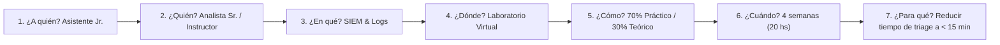

# RESOLUCIÓN OFICIAL: Trabajo Práctico N° 4.1 - Desarrollo de Recursos Humanos
**Cátedra:** Administración de Sistemas de Información (4° Nivel)  
**Facultad:** Universidad Tecnológica Nacional - Facultad Regional Resistencia (UTN FRRe)  
**Ciclo Lectivo:** 2026  
**Caso de Estudio:** Gerencia de Seguridad de la Información de CORREO ARGENTINO (CORASA).  
**Bibliografía de Referencia:** Idalberto Chiavenato (2005) "Administración de Recursos Humanos" (5ta Ed., Cap. 14 / Parte V).

---

## 📋 Contexto y Antecedentes del Caso
En el marco del plan de modernización y fortalecimiento de la ciberseguridad de **CORASA (Correo Oficial de la República Argentina S.A.)**, la Gerencia de Seguridad de la Información incorporó recientemente un **Asistente Jr. de Seguridad de la Información** (seleccionado a partir del perfil definido en el TP 2.1).

El área enfrenta desafíos críticos:
* Implementación de nuevas normativas de ciberseguridad bancaria y postal (BCRA, ISO 27001, Ley de Protección de Datos Personales).
* Migración de infraestructura física a la nube híbrida (AWS / Azure).
* Detección recurrente de ataques de phishing y ransomware dirigidos a las sucursales de correo en todo el país.
* Necesidad de estructurar un plan de desarrollo para que el Asistente Jr. cierre brechas operativas y pueda proyectar su plan de carrera hacia Analista Semi-Senior.

---

## 📝 RESOLUCIÓN PASO A PASO DE LAS CONSIGNAS

### Consigna 1) Inventario de Necesidades de Capacitación a Nivel Organizacional
*El análisis organizacional examina a la empresa en su conjunto: su misión estratégica, planes de expansión, metas de servicio, introducción de nuevas tecnologías y problemas globales que comprometen la competitividad.*

#### Inventario a Nivel Organizacional para CORASA:
1. **Capacitación en Cumplimiento Normativo y Gobernanza de Seguridad (ISO/IEC 27001 y Esquema Nacional de Ciberseguridad):**
   * *Justificación:* CORASA gestiona servicios postales, de paquetería crítica y transferencias monetarias. Requiere certificar y mantener estándares internacionales de gestión de seguridad de la información.
   * *Población objetivo:* Toda la Gerencia de Seguridad de la Información y mandos medios de SI/TI.
2. **Programa de Seguridad y Concientización contra Phishing e Ingeniería Social a Nivel Empresa:**
   * *Justificación:* Los empleados de sucursales postales son el vector de ataque más vulnerable ante correos fraudulentos.
   * *Población objetivo:* Todo el personal administrativo, operativo y de atención al público de CORASA.
3. **Gestión de Continuidad del Negocio (BCP) y Recuperación ante Desastres (DRP):**
   * *Justificación:* Asegurar la resiliencia operativa de los centros logísticos automatizados ante ciberataques o fallos masivos de infraestructura.
   * *Población objetivo:* Equipos de infraestructura, desarrollo, ciberseguridad y operaciones.

---

### Consigna 2) Inventario de Necesidades de Capacitación a Nivel de Recursos Humanos
*El análisis a nivel de recursos humanos examina a las personas: si el talento humano existente posee las competencias necesarias y suficientes para los roles actuales y futuros, detectando necesidades a partir de las evaluaciones de desempeño y rotación.*

#### Inventario a Nivel de Recursos Humanos para el Área de Seguridad de CORASA:
1. **Entrenamiento en Gestión de Incidentes Críticos y Respuesta Rápida (CSIRT / Blue Team):**
   * *Justificación:* Los Analistas Sr. y el Asistente Jr. deben actuar coordinadamente bajo protocolos estandarizados (NIST SP 800-61) para mitigar amenazas en tiempo real.
   * *Población:* Personal técnico del área de Seguridad de la Información.
2. **Desarrollo de Habilidades de Comunicación y Redacción de Informes Ejecutivos:**
   * *Justificación:* Se detecta dificultad en los especialistas técnicos para comunicar riesgos de ciberseguridad en lenguaje de negocio a la Alta Dirección.
   * *Población:* Analistas Sr. y Asistente Jr.
3. **Taller de Habilidades Blandas, Gestión del Estrés y Trabajo Colaborativo en Crisis:**
   * *Justificación:* La gestión continua de alertas de seguridad y guardias genera fatiga por alertas (*alert fatigue*) y desgaste emocional.
   * *Población:* Todo el equipo de la Gerencia de Seguridad.

---

### Consigna 3) Inventario de Necesidades de Capacitación a Nivel de Tareas y Operaciones
*El análisis a nivel de tareas examina los requisitos específicos del cargo (consignados en la Descripción y Análisis de Cargos - DyAC del TP 2.1) contrastados contra las habilidades y destrezas prácticas reales del ocupante.*

#### Cargo Analizado: Asistente Jr. de Seguridad de la Información

| Requisito del Cargo (DyAC TP 2.1) | Nivel Real Inicial del Asistente Jr. | Brecha / Necesidad de Entrenamiento Detectada |
| :--- | :--- | :--- |
| Monitoreo de alertas en herramientas SIEM (ej. Splunk, Wazuh, Elastic Security). | Conocimiento teórico básico universitario; sin experiencia en parametrización de reglas de correlación. | **Entrenamiento práctico en Operación de SIEM y Análisis de Logs de Eventos de Seguridad.** |
| Ejecución de escaneos de vulnerabilidades en endpoints y servidores (Nessus, OpenVAS). | Conoce conceptos de vulnerabilidades pero no ha configurado escaneos automatizados ni elaborado reportes de remediación. | **Taller en Ejecución e Interpretación de Vulnerability Scanners.** |
| Aplicación de políticas de control de acceso y gestión de identidades (Active Directory / Azure AD). | Manejo básico de usuarios; requiere dominar permisos basados en roles (RBAC) y autenticación multifactor (MFA). | **Capacitación en Administración Segura de Directorio Activo y Gestión de Accesos (IAM).** |
| Soporte en la atención y clasificación inicial de tickets de seguridad (phishing reportado). | Buen manejo general de tickets; requiere entrenamiento en análisis de cabeceras de emails y sandboxing de adjuntos. | **Instrucción en Análisis Inicial de Correos Maliciosos y Triage de Phishing.** |

---

### Consigna 4) Propuesta de Programa de Entrenamiento a Nivel de Tareas
*Diseño formal del programa para la necesidad: **"Operación de SIEM y Análisis de Logs de Seguridad para el Asistente Jr."***

Aplicando rigurosamente los **7 Interrogantes de la Programación del Entrenamiento (Chiavenato)**:

1. **¿A quién entrenar? (Población Objetivo):**
   * Asistente Jr. de Seguridad de la Información.
2. **¿Quién debe entrenar? (Instructor):**
   * Uno de los Analistas Sr. de Seguridad de la Información de CORASA (modalidad *mentoring/coaching*) complementado con acceso a cursos oficiales de la plataforma del SIEM.
3. **¿Sobre qué entrenar? (Contenido Temático):**
   * *Módulo 1 (5 h):* Arquitectura de logs (Syslog, Windows Event Logs, NetFlow) y recolección de eventos.
   * *Módulo 2 (5 h):* Creación de filtros, dashboards y búsquedas avanzadas en el SIEM.
   * *Módulo 3 (5 h):* Análisis de casos reales de falsos positivos y reglas de correlación de intrusiones.
   * *Módulo 4 (5 h):* Protocolo de escalamiento y documentación de tickets de incidentes en Jira.
4. **¿Dónde entrenar? (Lugar):**
   * Puesto de trabajo y entorno de laboratorio virtual (*Sandbox*) en las instalaciones de CORASA.
5. **¿Cómo entrenar? (Metodología Pedagógica):**
   * Método mixto: $30\%$ marco conceptual interactivo y $70\%$ resolución de incidentes simulados en tiempo real (*On-the-job training* con supervisión directa).
6. **¿Cuándo entrenar? (Cronograma y Horario):**
   * Duración total de 20 horas distribuidas en 4 semanas (2 sesiones semanales de 2.5 horas cada una, en horario laboral).
7. **¿Para qué entrenar? (Objetivos y Métricas de Evaluación):**
   * *Objetivo:* Lograr que el Asistente Jr. opere el SIEM de forma autónoma, reduciendo el tiempo medio de triage y primera clasificación de alertas de seguridad a menos de 15 minutos, con una precisión en la detección de falsos positivos $\ge 90\%$.
