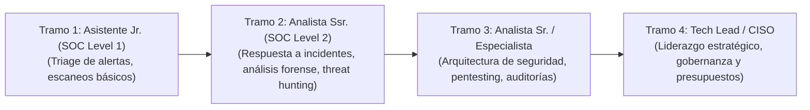

# RESOLUCIÓN OFICIAL: Trabajo Práctico N° 4.2 - Mantenimiento de Recursos Humanos
**Cátedra:** Administración de Sistemas de Información (4° Nivel)  
**Facultad:** Universidad Tecnológica Nacional - Facultad Regional Resistencia (UTN FRRe)  
**Ciclo Lectivo:** 2026  
**Caso de Estudio:** Gerencia de Seguridad de la Información de CORASA (Estructura Salarial, Beneficios, Costo Total, Plan de Carrera y Ergonomía).  
**Bibliografía de Referencia:** Idalberto Chiavenato (2005) Cap. 10, 11, 12; Anexos de Compensaciones Cátedra; Tabla CPCIPC Julio 2026; Ley 20.744 LCT.

---

## 📋 Estructura Actual del Área en CORASA

| Puesto | Cant. | Salario Básico Actual | Cargo Base Homologado | Situación Familiar y Antigüedad |
| :--- | :---: | :---: | :--- | :--- |
| **Gerente de Seguridad de la Información** | 1 | $\$3.564.994,04$ | Seguridad Informática (CPCIPC) | Casado, 2 hijos en edad escolar, 20 años de antigüedad. |
| **Analista Sr. de Seguridad de la Información (1)** | 1 | $\$2.800.000,00$ | Soporte User (Mercado local) | Casado, 1 hijo escolar, 1 hijo $>18$ años, 10 años antig. |
| **Analista Sr. de Seguridad de la Información (2)** | 1 | $\$2.800.000,00$ | Soporte User (Mercado local) | Soltero, 1 hijo de 2 años a cargo, 5 años antig. |
| **Asistente Jr. de Seguridad de la Información** | 1 | $\$1.800.000,00$ | Programador Senior (TP 2.1) | Soltero, 0 años de antigüedad (ingresante). |

---

## 📝 RESOLUCIÓN DETALLADA DE LAS CONSIGNAS

### Consigna b) Diagnóstico de la Estructura Actual y Medidas Recomendadas
#### Diagnóstico Crítico:
1. **Inequidad y Distorsión de Homologación:** Se homologó al Analista Sr. con "Soporte User" (un cargo de menor complejidad operativa) y al Asistente Jr. con "Programador Senior" (una categoría superior a su nivel). Esto vulnera la consistencia lógica interna.
2. **Criterio de Menor Valor:** Tomar "el menor valor de la tabla" desincentiva la atracción y retención de talento especializado en ciberseguridad, generando alto riesgo de fuga de cerebros hacia el sector privado.

#### Medidas Recomendadas:
* Implementar un método analítico formal de **Valuación de Puestos por Puntos (Merril R. Lott)** basado en las DyAC reales.
* Homologar cargos con categorías profesionales pertinentes del CPCIPC (ej. Especialista en Seguridad para Analistas Sr.; Soporte Técnico/Desarrollador Jr. para Asistente Jr.).
* Establecer **franjas salariales transparentes** con rangos mínimos, medios y máximos para permitir aumentos por mérito.

---

### Consigna c) Beneficios Sociales y Criterios de Remuneración Variable para el Asistente Jr.

#### 1. Beneficios Sociales Propuestos (Compensación Indirecta):
* **Medicina Prepaga Premium (Plan Familiar sin cargo):** Cobertura médica integral (Swiss Medical / OSDE).
* **Modalidad Híbrida y Subsidio de Conectividad:** 3 días de Home Office por semana más reintegro no remunerativo de gastos de Internet y energía.
* **Presupuesto Anual de Formación y Certificaciones:** Cobertura del $100\%$ para exámenes de certificación internacional (ej. CompTIA Security+, CEH, AWS Security Specialty).
* **Días de Estudio y Licencias Extra:** 5 días adicionales anuales para rendir exámenes universitarios en UTN.

#### 2. Criterios de Remuneración Variable (Incentivos al Desempeño):
* **Bono Semestral por Cumplimiento de OKRs individuales y de equipo:** Hasta 1 sueldo bruto adicional al año condicionado a métricas objetivas (ej. tiempo de triage $< 15 \text{ min}$, $0$ incidentes de seguridad no detectados en su turno).
* **Gratificación por Obtención de Certificaciones Técnicas:** Bono único equivalente al $50\%$ del sueldo básico al aprobar una certificación de ciberseguridad homologada por la gerencia.

---

### Consigna d) y e) Procedimiento y Cálculo del Costo Total Actual de la Estructura

#### Procedimiento de Cálculo Legal (LCT Argentina):
1. **Sueldo Básico:** Salario base de la posición.
2. **Adicional por Antigüedad:** Se aplica el $1\%$ o $2\%$ por año de antigüedad sobre el básico (se adopta estándar del $1.5\%$ por año para empresas de servicios).
3. **Sueldo Bruto:** $\text{Bruto} = \text{Básico} + \text{Antigüedad}$.
4. **Contribuciones Patronales a cargo de la Empresa:**
   * Cargas Sociales de Ley (Jubilación $10.17\%$, PAMI $1.5\%$, Obra Social $6\%$, Asignaciones $4.44\%$, FNE $0.89\%$ = **$24\%$** aprox.).
   * ART (Aseguradora de Riesgos del Trabajo) + Seguro de Vida: **$3\%$**.
   * Provisión de SAC ($8.33\%$) y Provisión de Cargas sobre SAC ($2.25\%$): **$10.58\%$**.
   * **Carga Patronal Total Estimada:** $\approx 37.58\%$ sobre el Sueldo Bruto.
5. **Asignaciones Familiares (ANSES):** Son financiadas por el Estado a través del SUAF (no representan costo directo adicional para el empleador si realiza los aportes de ley).
6. **Costo Total para la Empresa:** $\text{Costo Mensual} = \text{Sueldo Bruto} \times 1.3758$.

#### Cuadro de Cálculo del Costo Mensual Actual:

| Puesto | Sueldo Básico | Antigüedad (Años / %) | Adicional Antigüedad | Sueldo Bruto Remunerativo | Contribuciones Patronales ($37.58\%$) | Costo Total Empresa Mensual |
| :--- | :---: | :---: | :---: | :---: | :---: | :---: |
| **Gerente de Seguridad** | $\$3.564.994,04$ | 20 años ($30\%$) | $\$1.069.498,21$ | $\$4.634.492,25$ | $\$1.741.642,19$ | **$\$6.376.134,44$** |
| **Analista Sr. (1)** | $\$2.800.000,00$ | 10 años ($15\%$) | $\$420.000,00$ | $\$3.220.000,00$ | $\$1.210.076,00$ | **$\$4.430.076,00$** |
| **Analista Sr. (2)** | $\$2.800.000,00$ | 5 años ($7.5\%$) | $\$210.000,00$ | $\$3.010.000,00$ | $\$1.131.158,00$ | **$\$4.141.158,00$** |
| **Asistente Jr.** | $\$1.800.000,00$ | 0 años ($0\%$) | $\$0,00$ | $\$1.800.000,00$ | $\$676.440,00$ | **$\$2.476.440,00$** |
| **TOTAL GERENCIA** | **$\$10.964.994,04$** | — | **$\$1.699.498,21$** | **$\$12.664.492,25$** | **$\$4.759.316,19$** | **$\$17.423.808,44$** |

*El Costo Total actual de la estructura de la Gerencia de Seguridad es de **$\$17.423.808,44$ mensuales** (incluyendo previsiones patronales y aguinaldo).*

---

### Consigna f) Plan de Carrera del Asistente Jr. de Seguridad de la Información



#### Descripción de Concreción del Tramo 1 al Tramo 2 por el Líder:
* **Horizonte Temporal:** 18 a 24 meses.
* **Competencias a Desarrollar:** Análisis forense digital, scripting en Python para automatización de seguridad, gestión avanzada de firewalls y SIEM.
* **Acciones del Líder:**
  1. *Asignación de un Mentor:* Designar a un Analista Sr. para acompañamiento técnico semanal.
  2. *Proyectos Graduales:* Transferir paulatinamente la responsabilidad de investigar incidentes complejos de phishing y malware en sandbox.
  3. *Certificación Obligatoria:* Apoyar y financiar la obtención de la certificación *CompTIA CySA+ (Cybersecurity Analyst)* o *Blue Team Level 1*.
  4. *Evaluación Formal de Promoción:* Al cumplir 18 meses con desempeño "Sobresaliente", promover formalmente al cargo de Analista Ssr. con reajuste salarial de categoría.

---

### Consigna g) Estructura de Compensaciones y Recibo de Sueldo Sugerido para el Asistente Jr.

Tomando como referencia un Básico de Convenio actualizado de **$\$1.800.000,00$**:

```
================================================================================
                         RECIBO DE HABERES (SIMULACIÓN)
EMPLEADOR: CORASA S.A.                           LEGAJO: 9482
EMPLEADO: ASISTENTE JR. SEGURIDAD DE LA INFO     CUIL: 20-43892819-7
================================================================================
CÓDIGO   CONCEPTO                         HABERES REM.   DEDUCCIONES   NO REMUNER.
--------------------------------------------------------------------------------
100      Sueldo Básico                    $1.800.000,00
102      Adicional Presentismo (8.33%)      $149.940,00
         ----------------------------------------------
         TOTAL SUELDO BRUTO REMUNERATIVO  $1.949.940,00

201      Jubilación (SIPA 11%)                           $214.493,40
202      Ley 19.032 (PAMI 3%)                             $58.498,20
203      Obra Social (Ley 23.660 3%)                      $58.498,20
204      Cuota Sindical (2%)                              $38.998,80
         ----------------------------------------------
         TOTAL DEDUCCIONES                               $370.488,60

501      Subsidio Conectividad / Home Office                           $60.000,00
502      Reintegro Almuerzo / Viáticos                                 $80.000,00
         ----------------------------------------------
         TOTAL CONCEPTOS NO REMUNERATIVOS                             $140.000,00
--------------------------------------------------------------------------------
SUELDO NETO A COBRAR (EN BOLSILLO):                           $1.719.451,40
================================================================================
```

---

### Consigna i) Normas OSHA e IRAM en Entornos Informáticos y Propuesta de 2 Políticas

#### 1. Marco Normativo:
* **Normas OSHA (Occupational Safety and Health Administration):** Estándares de ergonomía en puestos de oficina con pantallas de visualización de datos (PVD / PPV), prevención de lesiones por esfuerzo repetitivo (RSI / síndrome del túnel carpiano), iluminación sin reflejos y pausas activas.
* **Normas IRAM (Instituto Argentino de Normalización):**
  * *IRAM 3753 / ISO 9241:* Requisitos ergonómicos para trabajos de oficina con pantallas de visualización (distancia monitor $50-70 \text{ cm}$, ángulo de visión $10°-20°$ bajo la horizontal, sillas ergonómicas regulables en 5 puntos).
  * *IRAM 4062:* Ruidos molestos en ambientes de trabajo (máximo recomendado en centros de cómputo: $55 \text{ dB(A)}$).

#### 2. Dos Políticas Formales para la Gerencia de SI/TI de CORASA:
1. **Política de Ergonomía, Pausas Activas y Prevención Visual (P-SITI-01):**
   * *Directiva:* Establecer la regla **20-20-20** (cada 20 minutos de pantalla continua, descansar 20 segundos mirando a 20 pies / 6 metros de distancia) y pausas activas obligatorias de 10 minutos cada 2 horas de trabajo para elongación muscular de muñecas, cuello y columna lumbar.
   * *Equipamiento:* Provisión obligatoria de sillas con apoyo lumbar regulable, teclados ergonómicos, mouse vertical y filtros antirreflejo para todos los monitores del área.
2. **Política de Desconexión Digital y Rotación de Guardias Pasivas (P-SITI-02):**
   * *Directiva:* Prohibir comunicaciones laborales y asignación de tickets no urgentes fuera del horario de jornada para preservar la salud mental y prevenir el síndrome de Burnout.
   * *Guardias:* Las guardias pasivas de ciberseguridad fines de semana deben ser rotativas semanales entre los integrantes del equipo, con compensación económica específica y día de descanso compensatorio posterior.
