# 📚 LIBRO DE ESTUDIO MAESTRO: UNIDAD 4 - DESARROLLO Y MANTENIMIENTO DE RRHH
**Cátedra:** Administración de Sistemas de Información (4° Nivel)  
**Facultad:** Universidad Tecnológica Nacional - Facultad Regional Resistencia (UTN FRRe)  
**Ciclo Lectivo:** 2026  
**Bibliografía Base Oficial:**
* Idalberto Chiavenato (2005) - *Administración de Recursos Humanos* (5ta Edición, McGraw-Hill, Capítulos 10, 11, 12, 14 / Partes IV y V).
* Material Sistematizado sobre Administración de Compensaciones (Cátedra AdmSI UTN FRRe).
* Tabla de Honorarios Recomendados CPCIPC (Consejo Profesional de Ciencias Informáticas de la Prov. de Córdoba).
* Normas Técnicas de Ergonomía para Pantallas de Visualización de Datos (IRAM 3753 / OSHA).
* Guías de Trabajos Prácticos TP 4.1 y TP 4.2 y Cuestionarios Oficiales UTN FRRe.

---

## 📑 ÍNDICE TEMÁTICO COMPLETO

* **[PARTE I: SUBSISTEMA DE DESARROLLO DE RECURSOS HUMANOS](#parte-i-subsistema-de-desarrollo-de-recursos-humanos)**
  1. [Conceptos Fundamentales: Educación, Capacitación y Desarrollo](#1-conceptos-fundamentales-educación-capacitación-y-desarrollo)
  2. [El Entrenamiento como Sistema Abierto](#2-el-entrenamiento-como-sistema-abierto)
  3. [Las Cuatro Etapas del Proceso de Entrenamiento](#3-las-cuatro-etapas-del-proceso-de-entrenamiento)
  4. [Diagnóstico e Inventario de Necesidades (Tres Niveles: Organizacional, RRHH, Tareas)](#4-diagnóstico-e-inventario-de-necesidades-de-entrenamiento)
  5. [Teoría y Leyes del Aprendizaje en las Organizaciones](#5-teoría-y-leyes-del-aprendizaje-en-las-organizaciones)
  6. [Programación y Diseño del Entrenamiento (Los 7 Interrogantes)](#6-programación-y-diseño-del-entrenamiento-los-7-interrogantes)
  7. [Técnicas y Métodos Pedagógicos de Entrenamiento](#7-técnicas-y-métodos-de-entrenamiento)
  8. [Evaluación de Resultados del Entrenamiento y Retorno de Inversión (ROI)](#8-evaluación-de-resultados-del-entrenamiento-y-roi)
  9. [Planes de Carrera y Progresión Profesional (Career Paths)](#9-planes-de-carrera-y-progresión-profesional-career-paths)
  10. [Desarrollo Organizacional (DO) y Gestión del Cambio](#10-desarrollo-organizacional-do)

* **[PARTE II: SUBSISTEMA DE MANTENIMIENTO DE RECURSOS HUMANOS](#parte-ii-subsistema-de-mantenimiento-de-recursos-humanos)**
  1. [Objetivos del Subsistema de Mantenimiento y Retención del Talento](#1-objetivos-del-subsistema-de-mantenimiento)
  2. [Teoría del Equilibrio Organizacional: Decisión de Participar vs. Decisión de Producir](#2-teoría-del-equilibrio-decisión-de-participar-vs-decisión-de-producir)
  3. [Administración de Compensaciones y Compuesto Salarial (Wage Mix)](#3-administración-de-compensaciones-y-compuesto-salarial)
  4. [Equidad Salarial y Teoría de la Inequidad de Adams](#4-equidad-salarial-y-teoría-de-la-inequidad-de-adams)
  5. [Valuación de Puestos: Métodos Tradicionales No Analíticos (Jerarquización, Categorías Predeterminadas)](#5-valuación-de-puestos-métodos-tradicionales)
  6. [Valuación de Puestos: Método Analítico por Puntos (Merril R. Lott)](#6-valuación-de-puestos-método-analítico-por-puntos-merril-r-lott)
  7. [Curva Salarial, Franjas Salariales y Política de Retribución](#7-curva-salarial-y-franjas-salariales)
  8. [Estructura Salarial en Argentina (Conceptos Remunerativos, Deducciones, SUAF)](#8-estructura-salarial-en-argentina)
  9. [Planes de Beneficios y Servicios Sociales (Asistenciales, Recreativos, Supletorios)](#9-planes-de-beneficios-y-servicios-sociales)
  10. [Higiene, Seguridad y Ergonomía PPV en Entornos Informáticos (IRAM / OSHA)](#10-higiene-seguridad-y-ergonomía-ppv-en-entornos-informáticos)

---
---

# PARTE I: SUBSISTEMA DE DESARROLLO DE RECURSOS HUMANOS

## 1. Conceptos Fundamentales: Educación, Capacitación y Desarrollo
En la visión sistémica de **Idalberto Chiavenato (2005)**, las personas son el único recurso vivo, inteligente y dinámico de la organización, capaz de aprender y perfeccionarse continuamente. El Subsistema de Desarrollo se encarga de potenciar este capital humano.

Es indispensable distinguir tres conceptos jerárquicos:
* **Educación:** Proceso global de socialización y formación general para la vida en sociedad (formación escolar y universitaria).
* **Entrenamiento / Capacitación (Training):** Proceso educativo a **corto plazo**, sistemático y formal, diseñado para transmitir conocimientos y habilidades técnicas específicas requeridas para el desempeño eficiente del **cargo actual**.
* **Desarrollo de Personas (Development):** Proceso a **mediano y largo plazo** orientado a formar competencias conceptuales, estratégicas y de liderazgo para preparar al individuo ante **futuras promociones y desafíos organizacionales** de mayor envergadura.

---

## 2. El Entrenamiento como Sistema Abierto
El entrenamiento funciona como un sistema abierto compuesto por 4 componentes esenciales interrelacionados:

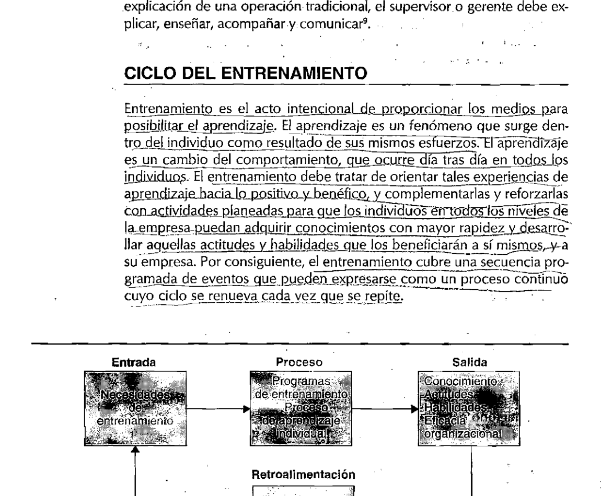

* **Entradas (Inputs):** Aprendices/empleados que requieren capacitación, instructores, materiales pedagógicos, recursos tecnológicos y presupuesto.
* **Procesamiento (Operación):** Ejecución del programa pedagógico (clases, talleres, laboratorios prácticos, e-learning).
* **Salidas (Outputs):** Personal capacitado con nuevas habilidades, conocimientos asimilados, cambios actitudinales y mayor productividad.
* **Realimentación (Feedback):** Evaluación continua de los resultados para ajustar futuras capacitaciones.

---

## 3. Las Cuatro Etapas del Proceso de Entrenamiento
El proceso de entrenamiento sigue un ciclo riguroso de cuatro etapas consecutivas:

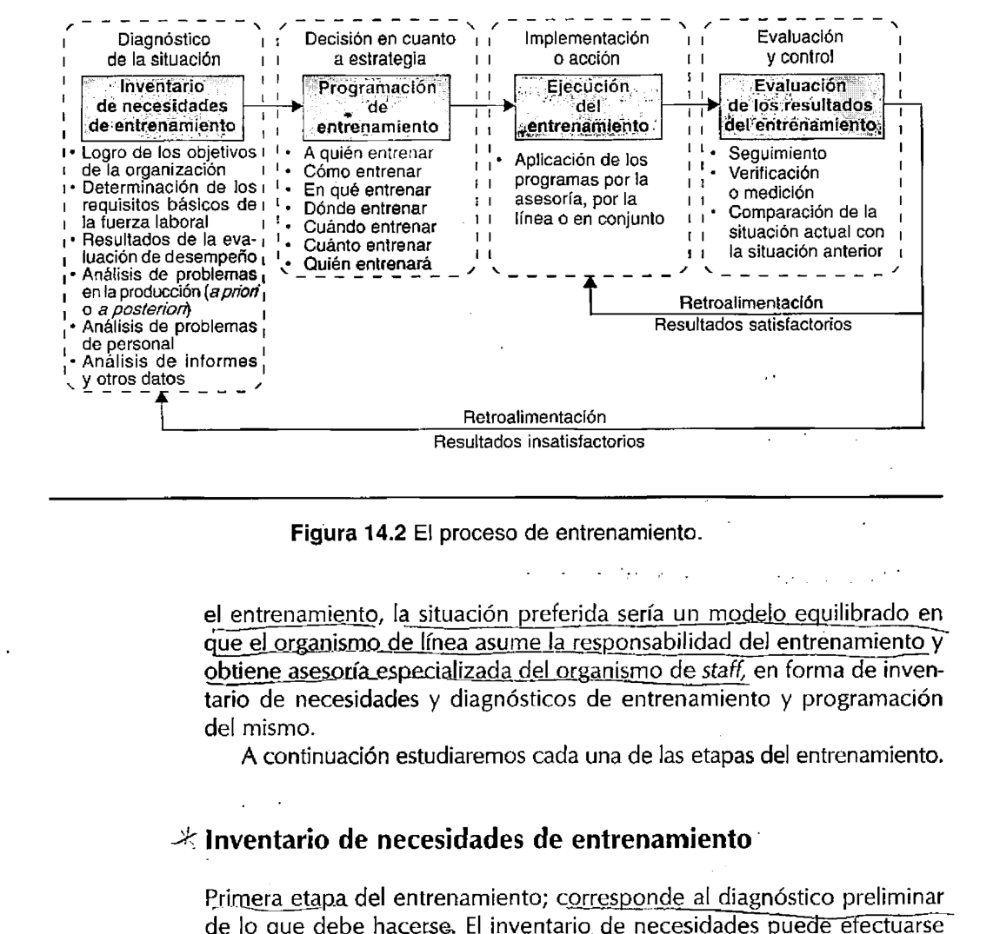

1. **Diagnóstico / Inventario de Necesidades:** Identificación formal de las carencias y brechas de conocimiento que deben ser satisfechas.
2. **Programación del Entrenamiento:** Diseño de la estrategia instruccional, contenidos, cronograma y recursos pedagógicos.
3. **Ejecución del Entrenamiento:** Aplicación práctica del programa a través de la interacción docente-aprendiz.
4. **Evaluación de Resultados:** Medición del impacto y retorno de inversión en el puesto de trabajo.

---

## 4. Diagnóstico e Inventario de Necesidades de Entrenamiento
Una **necesidad de entrenamiento** es una discrepancia o brecha entre lo que el empleado debería saber y hacer para ejecutar su cargo eficientemente (requisitos del puesto) y lo que realmente sabe y hace en la actualidad.

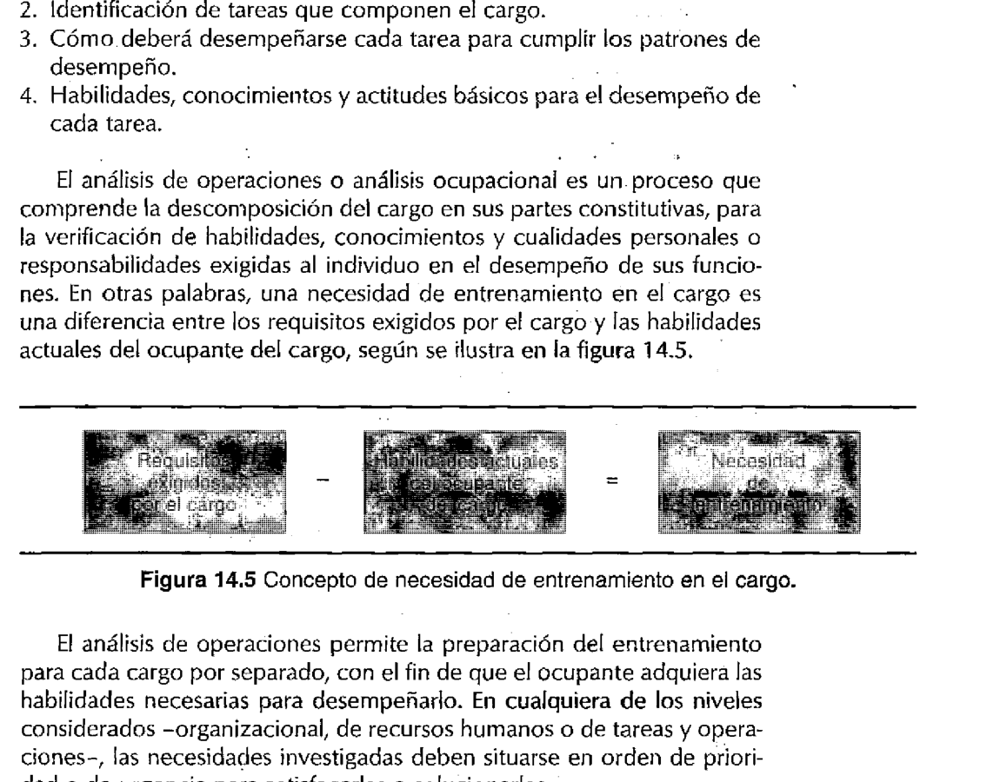

### Los Tres Niveles de Análisis del Inventario (Chiavenato):

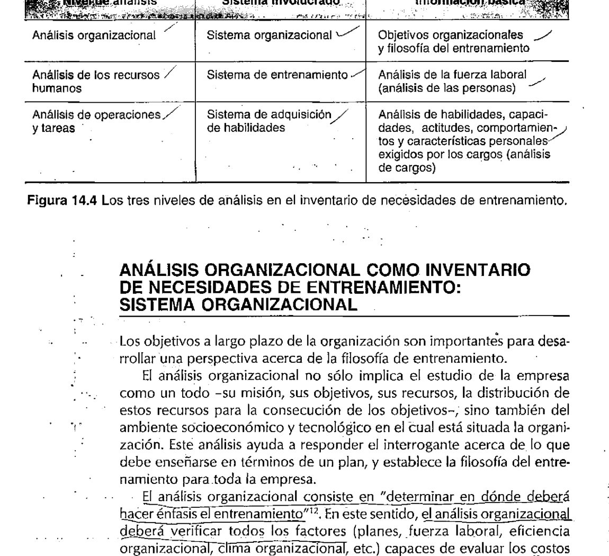

| Nivel de Análisis | Objeto de Examen | Qué Detecta | Ejemplos en Empresas de SI/TI |
| :--- | :--- | :--- | :--- |
| **1. Nivel Organizacional** | La empresa en su totalidad (misión, estrategia corporativa, crecimiento, nuevos mercados). | Necesidades globales para sostener la competitividad futura y adecuarse a nuevas regulaciones o tecnologías. | Plan de migración corporativa a Cloud (AWS/Azure); certificación ISO 27001 de seguridad; adopción de metodologías Agile/DevOps en toda la compañía. |
| **2. Nivel de Recursos Humanos** | El conjunto de personas y la fuerza laboral (inventario de habilidades, desempeño grupal, clima). | Discrepancias colectivas de rendimiento, perfiles escasos, problemas de liderazgo y habilidades blandas. | Dificultad de los líderes técnicos para gestionar equipos remotos; necesidad de mejorar la comunicación y redacción de reportes ejecutivos. |
| **3. Nivel de Tareas y Operaciones** | El puesto de trabajo individual y sus requisitos (consignados en la DyAC). | Habilidades operativas específicas que el ocupante no domina para cumplir los estándares de su tarea diaria. | Un Asistente Jr. de Seguridad no sabe configurar reglas de correlación en el SIEM o realizar triage de phishing en sandbox. |

---

## 5. Teoría y Leyes del Aprendizaje en las Organizaciones
El **aprendizaje** es la modificación relativamente permanente de la conducta como resultado de la experiencia y la práctica. En la psicología educativa aplicada a la empresa rigen las siguientes leyes fundamentales:
* **Ley del Efecto (Thorndike):** Las respuestas y conductas acompañadas de satisfacción o recompensas inmediatas tienden a fijarse y repetirse; las seguidas de frustración o castigo tienden a extinguirse.
* **Ley del Ejercicio (Uso y Desuso):** La práctica continua consolida las habilidades y destrezas; la falta de ejercicio produce olvido y pérdida de competencia.
* **Ley de la Disposición:** El individuo aprende rápida y profundamente cuando está motivado intrínsecamente y posee los conocimientos previos necesarios para asimilar el nuevo saber.
* **Ley de la Primacía y Recencia:** La primera impresión y los contenidos iniciales sientan las bases del aprendizaje, mientras que lo ejercitado al final de la sesión se retiene con mayor frescura.
* **Ley de la Intensidad:** Una experiencia práctica, vívida e inmersiva (simulaciones, laboratorios) produce un impacto de aprendizaje superior a una lectura pasiva.

---

## 6. Programación y Diseño del Entrenamiento (Los 7 Interrogantes)
La programación es la planificación curricular y logística del plan de acción para subsanar las necesidades diagnosticadas:

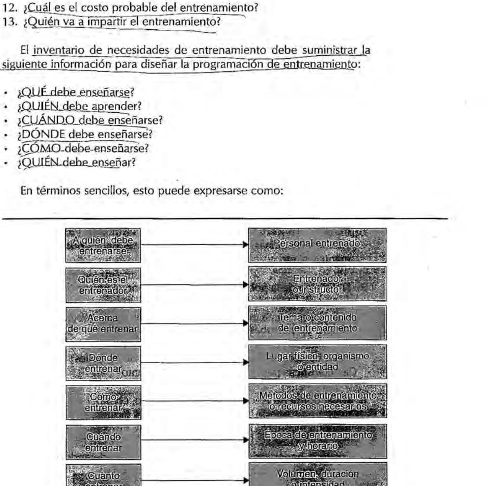

1. **¿A quién entrenar?** → Aprendices / Población objetivo.
2. **¿Quién debe entrenar?** → Instructor (interno o externo) / Mentor.
3. **¿Sobre qué entrenar?** → Contenido temático y habilidades a desarrollar.
4. **¿Dónde entrenar?** → Lugar físico, aula virtual, laboratorio o puesto de trabajo.
5. **¿Cómo entrenar?** → Métodos pedagógicos, recursos didácticos y tecnologías.
6. **¿Cuándo entrenar?** → Cronograma, frecuencia y horario laboral.
7. **¿Para qué entrenar?** → Objetivos de aprendizaje y métricas de desempeño esperadas.

---

## 7. Técnicas y Métodos de Entrenamiento
* **En el puesto de trabajo (On-the-job Training):** Instrucción directa del líder, rotación de puestos (*job rotation*), asignación de proyectos especiales, *coaching* y *mentoring*.
* **Fuera del puesto de trabajo (Off-the-job Training):** Clases presenciales, seminarios, simulación en entornos de prueba (*sandboxes*), plataformas e-learning autogestionadas.
* **Técnicas orientadas al proceso:** Dinámicas de grupo, juegos de rol (*role-playing*) y talleres de resolución de conflictos para desarrollo de habilidades interpersonales.

---

## 8. Evaluación de Resultados del Entrenamiento y ROI

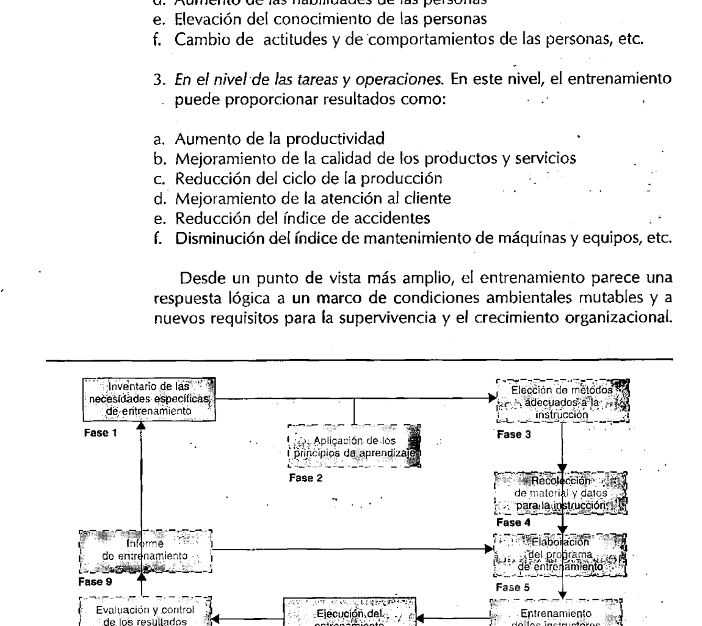

### Modelo de Evaluación de 4 Niveles (Donald Kirkpatrick):
1. **Nivel 1 - Reacción:** Satisfacción y percepción inmediata de los aprendices respecto al curso y al docente (encuestas de satisfacción).
2. **Nivel 2 - Aprendizaje:** Asimilación real de conceptos y habilidades técnicas (exámenes teóricos y pruebas de laboratorio).
3. **Nivel 3 - Comportamiento (Transferencia al puesto):** Aplicación efectiva de lo aprendido en el trabajo cotidiano (monitoreo del líder y reducción de errores).
4. **Nivel 4 - Resultados Organizacionales / ROI:** Impacto medible en los indicadores del negocio (aumento de productividad, reducción de bugs en producción, ahorro de costos).

---

## 9. Planes de Carrera y Progresión Profesional (Career Paths)
Un **Plan de Carrera** es un programa estructurado que define las secuencias de puestos y los requisitos de competencia que un colaborador puede recorrer dentro de la organización a lo largo del tiempo.
Equilibra dos factores indispensables:
* **Las aspiraciones individuales:** Expectativas de crecimiento, autonomía y salario del empleado.
* **Las necesidades estratégicas de la empresa:** Cobertura de vacantes críticas y sucesión de mandos medios y técnicos.

---

## 10. Desarrollo Organizacional (DO)
El **Desarrollo Organizacional** es un esfuerzo planificado a largo plazo, administrado desde la alta dirección, para mejorar los procesos de resolución de problemas, la renovación y la salud organizacional mediante una cultura colaborativa basada en la teoría de las ciencias de la conducta.

---
---

# PARTE II: SUBSISTEMA DE MANTENIMIENTO DE RECURSOS HUMANOS

## 1. Objetivos del Subsistema de Mantenimiento
El **Subsistema de Mantenimiento** de Chiavenato tiene por finalidad retener al personal calificado en la organización, garantizando un ambiente físico, psicológico y económico que estimule la permanencia, el compromiso y la motivación continua.

---

## 2. Teoría del Equilibrio: Decisión de Participar vs. Decisión de Producir
Basado en la teoría de March y Simon, Chiavenato explica que la relación entre el colaborador y la empresa es un intercambio dinámico de **Incentivos y Contribuciones**:
* **Decisión de Participar:** El individuo decide ingresar y permanecer en la empresa si los incentivos básicos (salario fijo, estabilidad, beneficios, clima) igualan o superan el costo de oportunidad de estar allí. *Asegura la retención.*
* **Decisión de Producir:** El individuo decide entregar su máximo esfuerzo, creatividad e iniciativa si percibe que un rendimiento superior será recompensado con incentivos directos (remuneración variable, bonos, promociones, reconocimiento). *Asegura la excelencia y la productividad.*

---

## 3. Administración de Compensaciones y Compuesto Salarial
La **compensación** abarca todas las formas de pago o recompensa otorgadas a los colaboradores:

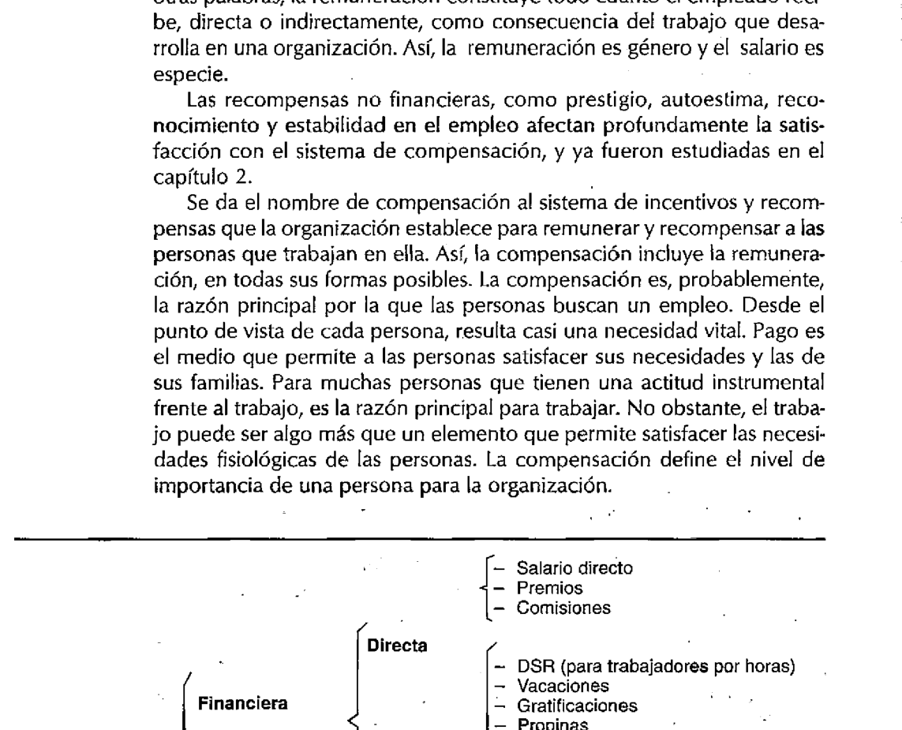

### El Compuesto Salarial (Wage Mix):
El nivel de los salarios dentro de una organización resulta de la interacción de factores internos y externos:

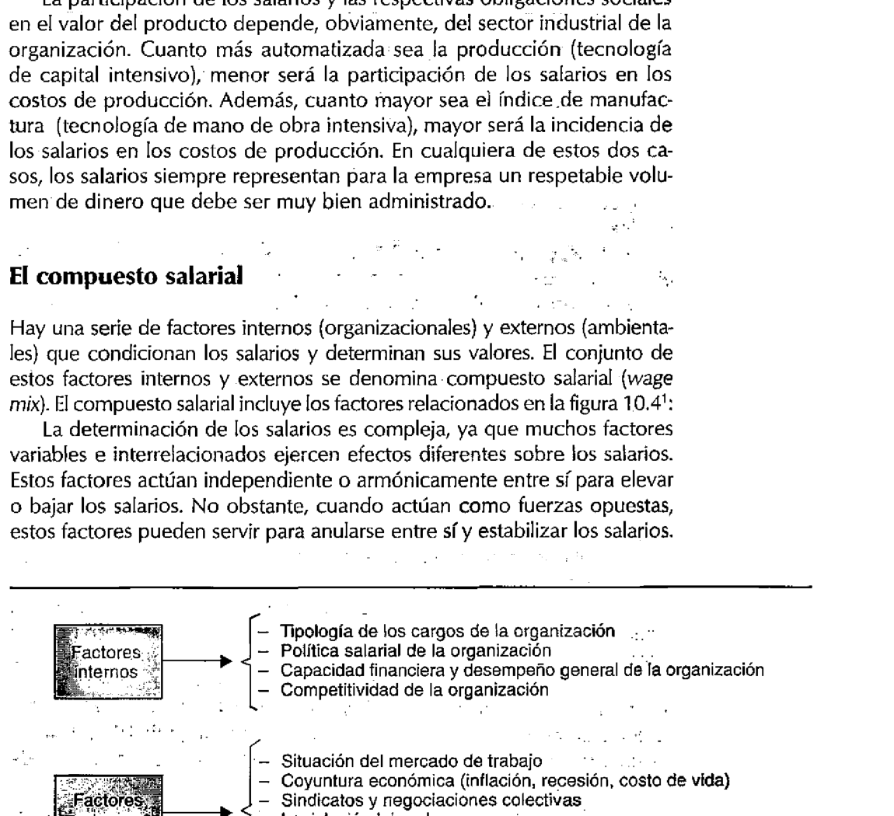

* **Factores Internos (Organizacionales):** Tipología y valuación de los cargos, política salarial interna, capacidad financiera de pago y desempeño de la empresa.
* **Factores Externos (Ambientales):** Situación del mercado laboral y de IT, leyes laborales y convenios colectivos, costo de vida / inflación, tablas de honorarios de colegios profesionales (CPCIPC) y poder sindical.

---

## 4. Equidad Salarial y Teoría de la Inequidad de Adams
En compensaciones no rige el principio de igualdad absoluta, sino el de **Equidad ("igual retribución para puestos de igual valor, y retribución proporcionalmente distinta para puestos de complejidad diferente")**.

$$\frac{\text{Resultados Propios (Salario, Beneficios)}}{\text{Aportes Propios (Esfuerzo, Educación, Horas)}} \quad \text{vs.} \quad \frac{\text{Resultados del Referente}}{\text{Aportes del Referente}}$$

Si la relación es desigual en perjuicio del empleado (inequidad negativa), este experimenta frustración y reduce su productividad, aumenta el ausentismo o renuncia.

---

## 5. Valuación de Puestos: Métodos Tradicionales
La **Valuación de Puestos** permite determinar la posición relativa de cada cargo dentro de la estructura jerárquica a partir de la **Descripción y Análisis de Cargos (DyAC)**.

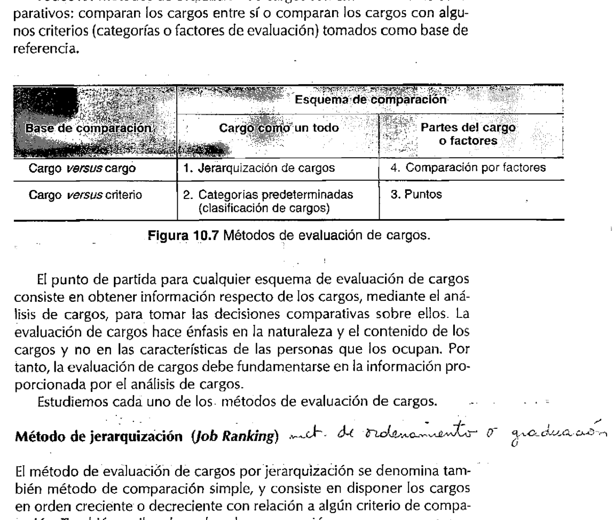

### A. Método de Jerarquización (Job Ranking - No analítico):
Se ordenan los puestos en una lista secuencial de mayor a menor importancia global por comparación directa.

### B. Método de Categorías Predeterminadas (Job Grading - No analítico):
Se definen previamente categorías genéricas (ej. Auxiliar, Técnico, Especialista, Gerencial) y luego se ubica cada cargo en el casillero correspondiente.

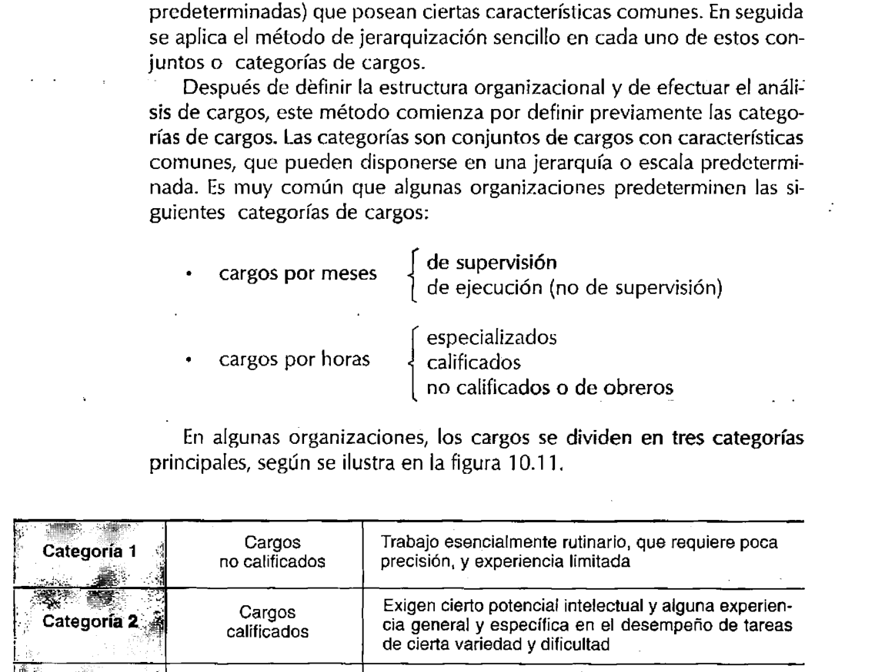

---

## 6. Valuación de Puestos: Método Analítico por Puntos (Merril R. Lott)
Es el método cuantitativo más exacto y utilizado en organizaciones de tecnología. Descompone los cargos en **factores compensables** (Requisitos Mentales, Físicos, Responsabilidad y Condiciones de Trabajo), subdivididos en grados con puntuaciones aritméticas o geométricas.

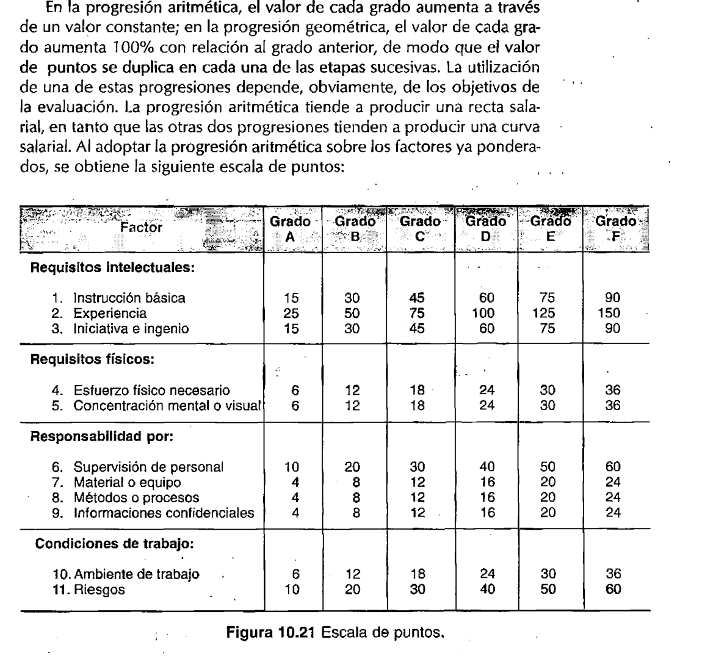

---

## 7. Curva Salarial y Franjas Salariales
Al correlacionar el valor en puntos de cada puesto ($x$) con su salario correspondiente en el mercado ($y$), se obtiene la **Línea de Tendencia o Curva Salarial** mediante regresión lineal ($y = ax + b$):

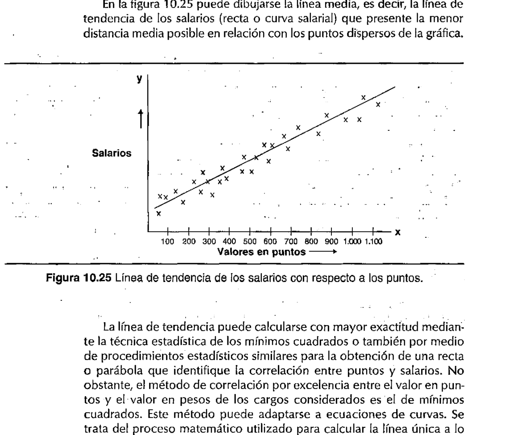

A partir de la curva se trazan las **Franjas Salariales**, con límites mínimos, medios y máximos, permitiendo la progresión salarial del empleado por desempeño sin necesidad de cambiar de cargo:

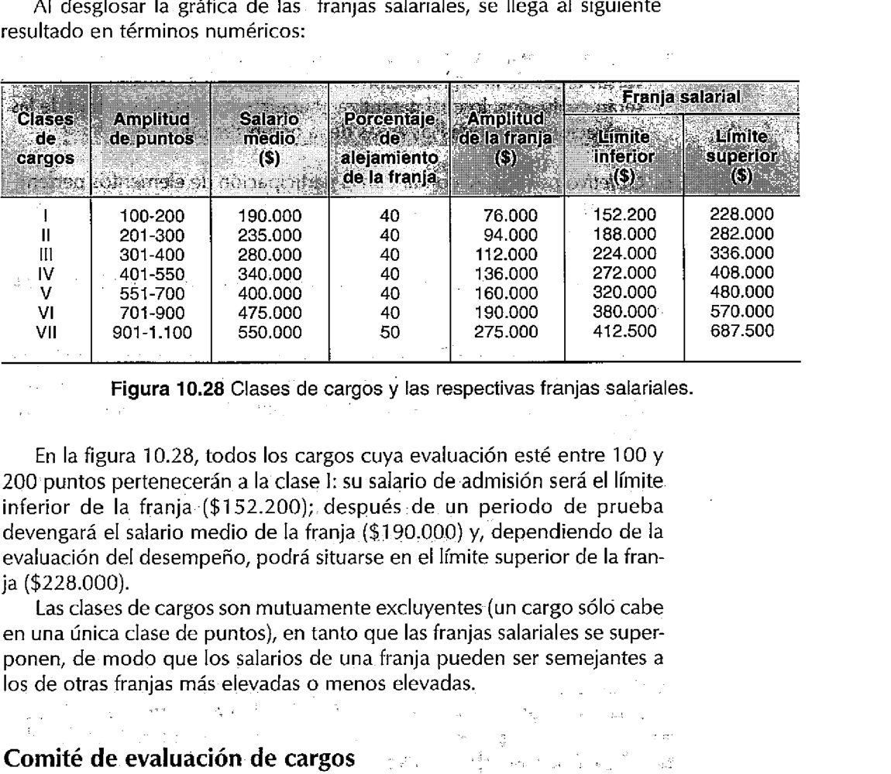

---

## 8. Estructura Salarial en Argentina
En el régimen de la Ley de Contrato de Trabajo N° 20.744 de Argentina, la retribución se estructura en:
* **Conceptos Remunerativos:** Sujetos a aportes y cargas patronales (Sueldo básico, antigüedad, presentismo, horas extra, SAC).
* **Conceptos No Remunerativos:** No gravados por seguridad social ordinaria (Asignaciones de ANSES, viáticos contra comprobante, subsidio de conectividad).
* **Retenciones al Trabajador:** $11\%$ Jubilación (SIPA), $3\%$ PAMI (Ley 19.032), $3\%$ Obra Social (Ley 23.660) y Cuota Sindical.
* **Contribuciones Patronales:** Aproximadamente un $37.58\%$ adicional sobre la masa salarial bruta a cargo exclusivo de la empresa.

---

## 9. Planes de Beneficios y Servicios Sociales

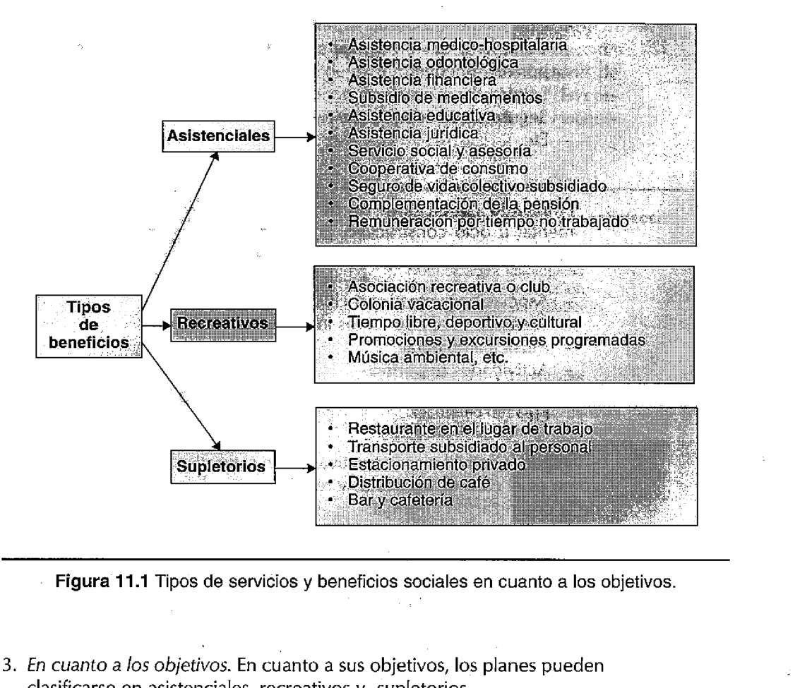

* **Beneficios Asistenciales:** Medicina prepaga premium, seguros de vida colectivos, asistencia odontológica y guardería.
* **Beneficios Recreativos:** Clubes corporativos, eventos de integración, convenios deportivos.
* **Beneficios Supletorios:** Comedor en planta, subsidio de transporte, flexibilidad horaria y teletrabajo.

---

## 10. Higiene, Seguridad y Ergonomía PPV en Entornos Informáticos
La **Higiene Laboral** preserva la salud física y mental del trabajador a través del control de las condiciones ambientales:

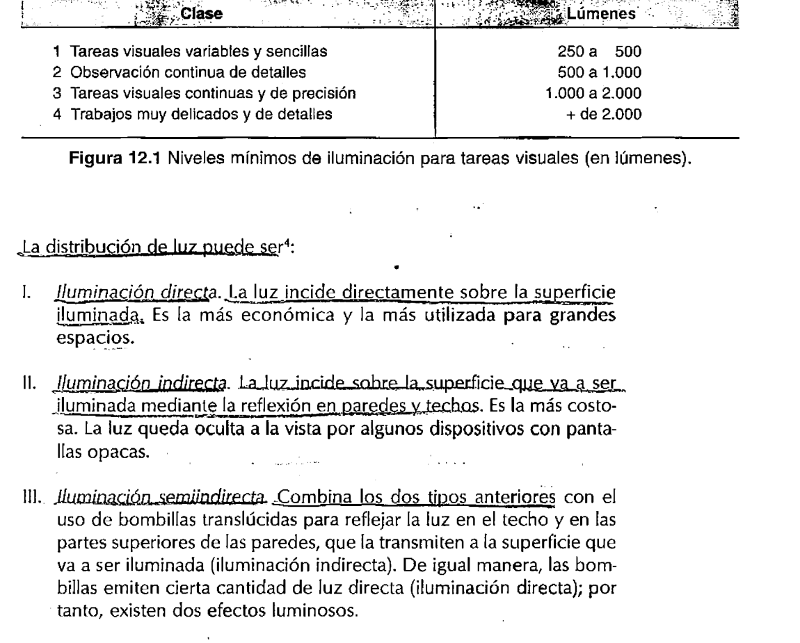

### Normas Técnicas para Pantallas de Visualización de Datos (PPV / IRAM 3753 / OSHA):
* **Ubicación de la Pantalla:** A una distancia de $50-70 \text{ cm}$ de los ojos, con el borde superior a la altura o ligeramente por debajo de la línea visual horizontal ($10°-20°$).
* **Iluminación:** Entre $300$ y $500 \text{ lux}$ en el plano de trabajo, evitando fuentes de luz directa o ventanas que generen reflejos sobre el monitor.
* **Silla Ergonómica:** Base de 5 ruedas con apoyo lumbar regulable en altura y profundidad; antebrazos apoyados horizontalmente a $90°$ respecto a la mesa.
* **Prevención de Enfermedades Profesionales:** Pausas activas periódicas para prevenir el Síndrome del Túnel Carpiano (tendinitis de muñeca), fatiga visual (*computer vision syndrome*) y lumbalgias.
