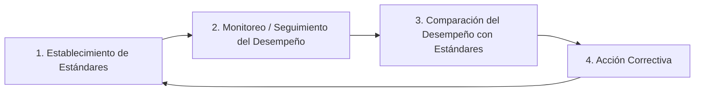

# RESOLUCIÓN OFICIAL: Cuestionario de Estudio - Subsistema de Seguimiento
**Universidad Tecnológica Nacional - Facultad Regional Resistencia**  
**Ingeniería en Sistemas de Información | Administración de Sistemas de Información (4° Nivel)**  
**Ciclo Lectivo: 2026**

---

# PARTE I: Seguimiento de Recursos Humanos (RRHH)
*Bibliografía: Chiavenato, Idalberto (2005) "Administración de Recursos Humanos" (5ta Ed.); Robbins & Coulter (2010); Koontz et al. (2008).*

---

### 1. ¿Qué procesos incluye el subsistema de control?
El **Subsistema de Control (o Monitoreo/Seguimiento) de Recursos Humanos** está integrado por los siguientes procesos fundamentales:
1. **Bases de Datos de Recursos Humanos:** Registro y almacenamiento sistemático de datos sobre personas, cargos, secciones y remuneraciones para mantener actualizada la información histórica y actual del personal.
2. **Sistemas de Información de Recursos Humanos (SIG / HRIS):** Estructura computarizada y procedimientos que recopilan, procesan, almacenan y distribuyen información para la toma de decisiones gerenciales y operativas.
3. **Auditoría de Recursos Humanos:** Proceso de análisis formal, sistemático y preventivo de las políticas y prácticas de personal para verificar su eficacia, grado de cumplimiento de estándares y alineamiento con los objetivos de la organización.
4. **Evaluación de Desempeño y Control Disciplinario:** Seguimiento del rendimiento del personal en base a estándares predefinidos y administración de la jornada de trabajo y disciplina laboral.

---

### 2. ¿Cuál es la diferencia entre dichos procesos?
* **Base de datos vs. Sistema de Información:** La base de datos es el *almacén o repositorio pasivo* estructurado de datos elementales; el Sistema de Información es el *proceso activo y dinámico* que transforma esos datos en información significativa y la pone a disposición de los usuarios y gerentes de línea para la toma de decisiones.
* **Sistema de Información vs. Auditoría:** El Sistema de Información recopila y suministra datos continuos sobre las operaciones diarias; la Auditoría es una *evaluación crítica, analítica y periódica* que juzga si el sistema de gestión de personas está funcionando con efectividad, detecta desviaciones y sugiere mejoras de políticas.
* **Control Operativo vs. Control Estratégico:** El registro de jornada y disciplina es de nivel *operativo e inmediato*; la auditoría y la planificación de RRHH son de nivel *estratégico*.

---

### 3. Etapas del proceso de control
El proceso o ciclo de control sigue una secuencia lógica de **4 etapas**:

1. **Establecimiento de Estándares deseados:** Definición de patrones y normas de desempeño expresados en 4 dimensiones de control:
   * *Cantidad:* Volumen de producción, horas de desarrollo, cantidad de tickets resueltos.
   * *Calidad:* Precisión, tasa de errores/bugs, satisfacción del cliente.
   * *Tiempo:* Tiempos de entrega, cumplimiento de cronogramas, tiempo de respuesta.
   * *Costo:* Presupuesto ejecutado, costo por hora-hombre, costo de reclutamiento.
2. **Monitoreo / Seguimiento del desempeño:** Medición sistemática y continua de lo que realmente se está ejecutando (a través de observación, reportes de actividad, logs de tickets y sistemas de información).
3. **Comparación del desempeño con los estándares:** Análisis de las diferencias o variaciones entre el desempeño real obtenido y el estándar esperado. Se aplica el principio de *Administración por Excepción* (solo se interviene si la desviación supera los límites de tolerancia aceptables).
4. **Acción correctiva:** Adopción de medidas para corregir desvíos (capacitación, reasignación de tareas, actualización de herramientas) o para reajustar los estándares si resultaron irreales o desactualizados.

---

### 4. ¿Tiene alguna relación con la Evaluación de Desempeño?
**Sí, una relación directa e intrínseca:**
* La **Evaluación del Desempeño** es el *instrumento operativo principal* de la segunda y tercera etapa del proceso de control: proporciona los datos cualitativos y cuantitativos sobre el rendimiento real de los colaboradores y permite contrastarlos contra los estándares del cargo.
* Aporta la retroalimentación (feedback) necesaria para ejecutar la cuarta etapa (acciones correctivas): planes de carrera, reentrenamiento, ascensos, incentivos o redefinición del perfil del puesto.

---

### 5. ¿De dónde proviene y cuál es la información que proveen los distintos subsistemas al Sistema de Información para el control?
El Sistema de Información de RRHH se nutre de las entradas generadas por los otros 4 subsistemas de gestión de personal:

| Subsistema de Origen | Información que provee al Sistema de Control |
| :--- | :--- |
| **1. Provisión (Admisión)** | Datos de reclutamiento, candidatos evaluados, perfiles de competencias, costos de contratación, fuentes de provisión más efectivas. |
| **2. Aplicación (Organización)** | Descripciones y especificaciones de cargos, organigrama, planes de trabajo, resultados de las Evaluaciones de Desempeño. |
| **3. Mantenimiento (Retención)** | Estructura salarial, beneficios otorgados, registros de ausentismo, accidentes laborales, clima organizacional y costos de compensación. |
| **4. Desarrollo (Capacitación)** | Historial de cursos y capacitaciones realizadas, horas de entrenamiento, evaluación del retorno de inversión (ROI) del aprendizaje. |

---

### 6. ¿Qué implica la auditoría de la función de personal de los gerentes de línea?
Implica evaluar cómo cada gerente o líder de área (gerente de línea con responsabilidad ejecutiva de personal) aplica las políticas, directivas y prácticas de RRHH con su equipo de trabajo. Verifica:
* Si realiza adecuadamente las evaluaciones de desempeño en tiempo y forma.
* Si gestiona con equidad y justicia las asignaciones y promociones.
* Si detecta necesidades de capacitación y apoya el desarrollo de sus subordinados.
* Si fomenta un clima laboral constructivo y cumple con las normas laborales y de seguridad.

---
---

# PARTE II: Subsistema de Seguimiento de SI/TI
*Bibliografía: Puigjaner et al. (1995) "Evaluación y explotación de sistemas informáticos"; Molero, Juiz y Rodeño (2004) "Evaluación y Modelado del Rendimiento de los Sistemas Informáticos".*

---

### 1. Dé el concepto de cuello de botella. ¿Cuál es el procedimiento para solucionarlos?
* **Concepto:** El **cuello de botella (bottleneck)** es aquel componente o recurso del sistema informático (CPU, memoria, disco/almacenamiento, ancho de banda de red) que presenta la **mayor demanda de servicio ($D_{max}$)** o la **máxima utilización ($U_{max}$)**. Es el factor limitante que restringe la productividad global ($X_{max} = 1 / D_{max}$) y satura el sistema antes que los demás.
* **Procedimiento para solucionarlo:**
  1. *Identificación:* Medir la demanda de servicio y utilización de cada componente para detectar cuál tiene la mayor demanda ($D_i$).
  2. *Optimización/Aceleración:* Aplicar mejoras en el recurso crítico (upgrade de hardware, optimización de consultas SQL, indexación, balanceo de carga, caching).
  3. *Reevaluación:* Al solucionar el cuello de botella actual, la saturación se desplazará hacia el segundo componente más demandado, por lo que debe repetirse el proceso de análisis operacional de forma iterativa.

---

### 2. ¿Cuáles son las técnicas para evaluar sistemas informáticos?
Existen **3 grandes familias de técnicas**:
1. **Técnicas de Medición (Monitorización y Benchmarking):** Observación directa del sistema real en funcionamiento mediante herramientas de monitorización (hardware, software, híbridos) o ejecución de bancos de prueba estandarizados (*benchmarks*).
2. **Técnicas de Modelado Analítico:** Uso de herramientas matemáticas y formalismos teóricos (Análisis Operacional, Redes de Colas, Cadenas de Markov) para predecir el comportamiento del sistema a partir de leyes formales (Ley de Little, Ley de Utilización).
3. **Técnicas de Simulación:** Modelos informáticos que reproducen el comportamiento dinámico del sistema a través de eventos discretos cuando los modelos analíticos matemáticos se vuelven intratables.

---

### 3. La Ley de Amdahl: Sintetizar el significado de la ley. ¿Qué tipo de técnica de evaluación es? ¿Para qué sirve al administrador de recursos?
* **Significado:** La Ley de Amdahl establece el límite teórico máximo de aceleración (*Speedup* global) que puede alcanzar un sistema informático cuando se mejora una fracción específica de sus componentes o tareas.
  $$\text{Aceleración Global } S = \frac{1}{(1 - f) + \frac{f}{k}}$$
  Donde $f$ es la fracción del tiempo de ejecución que se ve beneficiada por la mejora, y $k$ es el factor de aceleración local de esa fracción.
* **Tipo de técnica:** Es una **técnica de modelado analítico / evaluación teórica**.
* **Utilidad para el administrador de SI/TI:** Permite evaluar la relación costo-beneficio antes de realizar inversiones de hardware o refactorización de software. Ayuda a no sobredimensionar componentes que solo participan en una fracción mínima del tiempo total de procesamiento.

---

### 4. Dé el concepto de MONITOR. Detalle todas las características que debe cumplir. ¿Qué es monitorizar?
* **Concepto de Monitor:** Es un dispositivo o conjunto de rutinas (hardware, software o híbrido) diseñado para observar, recolectar y registrar información sobre los eventos, actividades y estados de los recursos de un sistema informático durante su funcionamiento.
* **Características obligatorias que debe cumplir:**
  1. **Baja Interferencia (Artifact):** Debe consumir el mínimo posible de recursos del sistema para no alterar el rendimiento que está intentando medir.
  2. **Alta Resolución:** Debe ser capaz de registrar eventos con la precisión temporal requerida (milisegundos o microsegundos).
  3. **Dominio de medición adecuado:** Capacidad de capturar el espectro de eventos de interés (instrucciones, llamadas al SO, tráfico de red, memoria).
  4. **Precisión y Fidelidad:** Los datos registrados deben reflejar exactamente la realidad operativa.
  5. **Facilidad de parametrización y reducción de datos:** Capacidad de filtrar eventos y presentar resúmenes procesables.
* **Monitorizar un sistema informático:** Es el proceso sistemático de registrar continuamente variables operacionales de rendimiento (utilización de CPU, I/O, tráfico de red, memoria, tiempos de respuesta) para diagnóstico de anomalías, afinamiento (*tuning*), seguridad y planificación de capacidad.

---

### 5. Describa los tipos de técnica de monitorización de sistemas informáticos
1. **Monitorización por Eventos (Event-driven):** El monitor se activa únicamente cuando ocurre un evento específico de interés (e.g., interrupción, llamada al sistema `syscall`, error de página de memoria). Ideal para eventos infrecuentes de alta relevancia.
2. **Monitorización por Muestreo (Sampling / Polling):** El monitor se activa a intervalos regulares de tiempo predeterminados para inspeccionar el estado de las variables y contadores del sistema. Consume recursos predecibles y es ideal para métricas continuas (uso de CPU, memoria).

---

### 6. Analice el esquema estructural del monitor
Todo monitor se compone estructuralmente de **4 bloques funcionales**:
1. **Sensor (Mecanismo de Detección):** Punto de enganche que detecta la ocurrencia del evento o captura la muestra (sondas físicas, hooks de software, interrupciones).
2. **Recolector / Unidad de Control:** Recibe la señal del sensor, valida las condiciones de filtrado y decide si el dato debe ser registrado.
3. **Almacenamiento Temporal (Buffer de Memoria):** Almacena transitoriamente los eventos capturados en memoria de alta velocidad para minimizar demoras.
4. **Unidad de Salida / Visualizador / Analizador:** Escribe los datos en almacenamiento permanente (logs, series temporales) o genera gráficos e indicadores en tiempo real para el administrador.

---

### 7. Describa la clasificación de los monitores
1. **Monitores Software:** Rutinas de código integradas en el sistema operativo, hypervisor o aplicación que leen contadores y estructuras del kernel.
2. **Monitores Hardware:** Dispositivos físicos externos dotados de sondas y contadores que se conectan a buses o circuitos electrónicos del computador.
3. **Monitores Híbridos:** Combinación donde el software detecta los eventos lógicos y genera señales que son capturadas y almacenadas por un hardware externo especializado sin sobrecargar la CPU principal.

---

### 8. Sintetice el funcionamiento de los monitores software. Consideraciones temporales planteadas por los autores
* **Funcionamiento:** Se ejecutan como procesos o módulos del sistema operativo. Interceptan llamadas al sistema, leen registros de `/proc` o `/sys`, recolectan métricas y las vuelcan en archivos de registro (como `sar`, `vmstat`, `iostat`, `Prometheus Node Exporter`).
* **Consideraciones temporales:**
  * *Interferencia:* Al compartir CPU, memoria y bus con las tareas del usuario, el monitor software introduce una distorsión temporal (tiempo de ejecución propio).
  * *Período de muestreo:* Si el intervalo de muestreo es muy corto, la sobrecarga (*overhead*) es alta; si es muy largo, se pierden ráfagas y transitorios rápidos. Los autores recomiendan calibrar la frecuencia de muestreo según la dinámica del recurso.

---

### 9. Sintetice el funcionamiento de los monitores hardware
* **Funcionamiento:** Operan mediante sondas físicas (clips lógicos o analizadores de bus) adheridas a los pines del procesador, memorias o buses de comunicación. Cuentan pulsos de reloj y transiciones de estado a nivel electrónico sin requerir ningún ciclo de reloj ni memoria del procesador anfitrión.

---

### 10. ¿Cuál es la principal utilización de los monitores híbridos?
La principal utilización de los monitores híbridos es **medir eventos lógicos y de software complejos (como inicio/fin de transacciones, ejecución de rutinas de usuario) con cero interferencia en el almacenamiento y procesamiento**, delegando la captura física y el registro de alta velocidad a un hardware dedicado. Se utilizan en sistemas de misión crítica, tiempo real estricto y en el diseño/depuración de microprocesadores y sistemas embebidos.

---

### 11. Cuadro comparativo de Monitores Software vs. Monitores Hardware

| Característica | Monitores Software | Monitores Hardware |
| :--- | :--- | :--- |
| **Dominio de medición** | Eventos lógicos de alto nivel: procesos, usuarios, llamadas al sistema operativo, archivos abiertos, hilos, errores de aplicación. | Eventos físicos de bajo nivel: ciclos de reloj, señales de buses, líneas de interrupción, accesos a bancos de memoria. |
| **Resolución** | Menor resolución temporal (generalmente en el orden de milisegundos o microsegundos). | Máxima resolución temporal (orden de nanosegundos / ciclos de reloj individuales). |
| **Interferencia** | **Existe interferencia (overhead):** consume ciclos de CPU, memoria y ancho de banda de E/S. | **Interferencia nula (cero overhead):** no consume recursos del sistema anfitrión. |

---

### 12. Diferencie benchmark de benchmarking. Factores, errores y circunstancias influyentes
* **Diferencia:**
  * **Benchmark:** Es el *programa, conjunto de pruebas o carga estandarizada* que se utiliza para someter a prueba un sistema y medir su comportamiento cuantitativo.
  * **Benchmarking:** Es el *proceso metodológico integral y sistemático* de diseñar experimentos, ejecutar los benchmarks, recolectar mediciones, comparar alternativas y sacar conclusiones para la toma de decisiones.
* **Factores que influyen en el benchmarking:** Entorno de ejecución (versión de SO, drivers, flags del compilador), estado inicial de cachés, temperatura de hardware, concurrencia de procesos en segundo plano, representatividad de la carga respecto a la realidad del negocio.
* **Errores frecuentes:**
  * Utilizar benchmarks sintéticos irrelevantes para el caso real (ej. probar punto flotante cuando el sistema es transaccional I/O-bound).
  * No calentar cachés (*warm-up phase*) antes de iniciar la medición.
  * Extrapolar resultados de pruebas en micro-laboratorio a arquitecturas masivas de producción.
* **Circunstancias influyentes:** Cargas en background no controladas, variabilidad de red, políticas de ahorro energético/throttling térmico.

---

### 13. ¿Cuáles son las unidades utilizadas en benchmarking?
* **Rendimiento de procesamiento:** MIPS (Millones de Instrucciones Por Segundo), FLOPS / GFLOPS / TFLOPS (Operaciones de Punto Flotante por Segundo).
* **Throughput transaccional:** TPS (Transacciones Por Segundo), QPS (Queries Por Segundo), RPS (Requests Por Segundo).
* **Tiempo:** Tiempo de respuesta (ms/s), Latencia percentil p95/p99 (ms).
* **Índices normalizados:** SPECint, SPECfp, ratios respecto a una máquina de referencia (*SPECmark*).

---

### 14. ¿Qué es un benchmark general?
Un **benchmark general (o sintético estandarizado)** es un banco de pruebas compuesto por un conjunto diverso de algoritmos o rutinas diseñadas para medir las capacidades promedio globales de un sistema (cálculo de CPU, acceso a memoria, lectura/escritura de disco y gráficos), en lugar de evaluar una aplicación específica de negocio. Ejemplos clásicos: *SPEC CPU*, *PCMark*, *Geekbench*, *SysBench*.

---

### 15. ¿Qué puede utilizarse para monitorizar computadores personales y smartphones?
* **En Computadores Personales (Windows / macOS / Linux):**
  * *Herramientas de SO integradas:* Administrador de Tareas y Monitor de Recursos (Windows), Monitor de Actividad y `top`/`powermetrics` (macOS), `htop`, `sar`, `vmstat`, `glances` (Linux).
  * *Monitores avanzados y hardware:* HWMonitor, HWiNFO64, Intel VTune, Sysinternals Suite (Process Explorer).
* **En Smartphones (Android / iOS):**
  * *Android:* Android Studio Profiler, Perfetto, Simpleperf, GPU Profiler, comandos ADB (`adb shell dumpsys cpuinfo`, `meminfo`, `batterystats`), aplicaciones como DevCheck o Geekbench.
  * *iOS:* Apple Instruments (Xcode Profiler: Time Profiler, Allocations, Network), Xcode Organizer Metrics.
