# 📚 LIBRO DE ESTUDIO MAESTRO: UNIDAD 5 - SEGUIMIENTO DE SI/TI & RECURSOS HUMANOS
**Cátedra:** Administración de Sistemas de Información (4° Nivel)  
**Facultad:** Universidad Tecnológica Nacional - Facultad Regional Resistencia (UTN FRRe)  
**Ciclo Lectivo:** 2026  
**Bibliografía Base Oficial:**
* Idalberto Chiavenato (2005) - *Administración de Recursos Humanos* (5ta Edición, McGraw-Hill).
* Xavier Molero, Carlos Juiz y F. Rodeño (2004) - *Evaluación y Modelado del Rendimiento de los Sistemas Informáticos* (Pearson / Prentice Hall).
* Ramón Puigjaner et al. (1995) - *Evaluación y explotación de sistemas informáticos*.
* Stephen Robbins y Mary Coulter - *Administración* (10ma Edición).
* Guías de Trabajos Prácticos y Cuestionarios Oficiales UTN FRRe.

---

## 📑 ÍNDICE TEMÁTICO COMPLETO

* **[PARTE I: SUBSISTEMA DE SEGUIMIENTO Y CONTROL DE RECURSOS HUMANOS](#parte-i-subsistema-de-seguimiento-y-control-de-recursos-humanos)**
  1. [Teoría General del Control y Enfoque Cibernético](#1-teoría-general-del-control-y-enfoque-cibernético)
  2. [Los Tres Niveles de Control Organizacional](#2-los-tres-niveles-de-control-organizacional)
  3. [Las Cuatro Etapas del Ciclo de Control](#3-las-cuatro-etapas-del-ciclo-de-control)
  4. [Principio de Administración por Excepción](#4-principio-de-administración-por-excepción)
  5. [Las Cuatro Dimensiones de los Estándares de Desempeño](#5-las-cuatro-dimensiones-de-los-estándares-de-desempeño)
  6. [Evaluación del Desempeño Humano (Concepto y Modelos de Responsabilidad)](#6-evaluación-del-desempeño-humano)
  7. [Métodos Tradicionales de Evaluación del Desempeño](#7-métodos-tradicionales-de-evaluación-del-desempeño)
     * *7.1 Método de Escalas Gráficas (Graphic Rating Scales)*
     * *7.2 Método de Elección Forzada (Forced Choice)*
     * *7.3 Método de Incidentes Críticos*
     * *7.4 Método de Investigación de Campo*
     * *7.5 Método de Comparación por Pares y Frases Descriptivas*
  8. [Métodos Modernos de Evaluación](#8-métodos-modernos-de-evaluación)
     * *8.1 Evaluación de 360 Grados (Feedback Circular)*
     * *8.2 Evaluación Participativa por Objetivos (EPPO / OKRs)*
  9. [Sesgos Cognitivos y Distorsiones de Medición del Evaluador](#9-sesgos-cognitivos-y-distorsiones-de-medición-del-evaluador)
  10. [La Entrevista de Evaluación y Retroalimentación](#10-la-entrevista-de-evaluación-y-retroalimentación)
  11. [Bases de Datos y Sistemas de Información de RRHH (SIG/HRIS)](#11-bases-de-datos-y-sistemas-de-información-de-rrhh-sighris)
  12. [Auditoría de Recursos Humanos](#12-auditoría-de-recursos-humanos)

* **[PARTE II: SUBSISTEMA DE SEGUIMIENTO DE SOFTWARE Y HARDWARE (SI/TI)](#parte-ii-subsistema-de-seguimiento-de-software-y-hardware-siti)**
  1. [Fundamentos y Objetivos del Seguimiento de SI/TI](#1-fundamentos-y-objetivos-del-seguimiento-de-siti)
  2. [Las Tres Familias de Técnicas de Evaluación (Medición, Modelado Analítico, Simulación)](#2-las-tres-familias-de-técnicas-de-evaluación)
  3. [Análisis Operacional: Supuesto de Balance y Estaciones de Servicio](#3-análisis-operacional-balance-y-estaciones-de-servicio)
  4. [Variables Operacionales Básicas ($T, A, C, B$) y Deducidas ($\lambda, X, U, S, R, W, Q$)](#4-variables-operacionales-básicas-y-deducidas)
  5. [Demostración Formal de las Leyes Operacionales](#5-demostración-formal-de-las-leyes-operacionales)
     * *5.1 Ley de Utilización ($U = X \cdot S$)*
     * *5.2 Ley de Little ($N = X \cdot R$)*
     * *5.3 Ley de Flujo Forzado ($X_k = V_k \cdot X_0$)*
     * *5.4 Demanda de Servicio ($D_k = V_k \cdot S_k$)*
  6. [Ley del Tiempo de Respuesta Interactivo (Ley de Bruni / Chatbots y Web)](#6-ley-del-tiempo-de-respuesta-interactivo-ley-de-bruni)
  7. [Cuello de Botella ($D_{\max}$) y Límites Asintóticos de Rendimiento](#7-cuello-de-botella-d_max-y-límites-asintóticos-de-rendimiento)
  8. [Punto de Saturación ($N^*$) y Procedimiento de Mitigación](#8-punto-de-saturación-n-y-procedimiento-de-mitigación)
  9. [Ley de Amdahl: Formulación, Demostración y Límite Teórico de Speedup](#9-ley-de-amdahl-formulación-demostración-y-límite-teórico)
  10. [Monitores de Sistemas Informáticos (Requisitos, Bloques y Clasificación HW vs. SW vs. Híbridos)](#10-monitores-de-sistemas-informáticos)
  11. [Monitoreo por Muestreo vs. Eventos y Telemetría Linux (`top`, `vmstat`, `sar`)](#11-monitoreo-por-muestreo-vs-eventos-y-telemetría-linux)
  12. [Benchmarking: Concepto, Tipos y Caso SysBench Memoria RAM (Bloque-Límite)](#12-benchmarking-de-sistemas-informáticos)

---
---

# PARTE I: SUBSISTEMA DE SEGUIMIENTO Y CONTROL DE RECURSOS HUMANOS

## 1. Teoría General del Control y Enfoque Cibernético
En el marco teórico formulado por **Idalberto Chiavenato (2005)**, la Administración de Recursos Humanos (ARH) es un sistema abierto integrado por cinco subsistemas interdependientes:
1. **Provisión (Admisión):** Quién trabajará en la empresa (reclutamiento y selección).
2. **Aplicación (Organización):** Qué harán las personas (diseño de cargos y evaluación del desempeño).
3. **Mantenimiento (Retención):** Cómo conservarlas (remuneración, beneficios, higiene y seguridad laboral).
4. **Desarrollo (Capacitación):** Cómo prepararlas y desarrollarlas (entrenamiento y plan de carrera).
5. **Seguimiento y Control (Monitoreo):** Cómo saber quiénes son y qué hacen (bases de datos, sistemas de información, disciplina y auditoría).

El **Subsistema de Control o Seguimiento** cierra el circuito sistémico. Desde la perspectiva cibernética, el control **no debe entenderse como un acto policial, punitivo o coercitivo de fiscalización**, sino como un **proceso autorregulador de realimentación (feedback)** continuo. Su finalidad es monitorear el comportamiento real de los recursos humanos, confrontarlo con los planes estratégicos, detectar desviaciones a tiempo e implementar ajustes proactivos para mantener a la organización en su rumbo.

---

## 2. Los Tres Niveles de Control Organizacional
El control del factor humano opera en tres niveles jerárquicos complementarios:
* **Nivel Estratégico (Institucional):** Monitorea el impacto global y a largo plazo de las políticas de talento sobre la supervivencia y competitividad corporativa. Indicadores típicos: índice global de rotación (*turnover*), balance social, auditoría general de recursos humanos, retorno de inversión del capital intelectual.
* **Nivel Táctico (Departamental):** Supervisa la gestión por áreas funcionales y proyectos a mediano plazo. Indicadores típicos: presupuesto asignado al área de desarrollo de software, cumplimiento de planes de formación técnica, tasa de retención de perfiles Senior.
* **Nivel Operacional:** Control diario, directo y de tarea inmediata. Indicadores típicos: registro de jornada y asistencia, cantidad de tickets de soporte N2 cerrados por operador, cumplimiento de entregables de un Sprint en Jira, adherencia a estándares de documentación y código.

---

## 3. Las Cuatro Etapas del Ciclo de Control
Todo proceso de control sistemático y metódico se estructura en **cuatro etapas consecutivas e interconectadas** en un bucle cerrado:

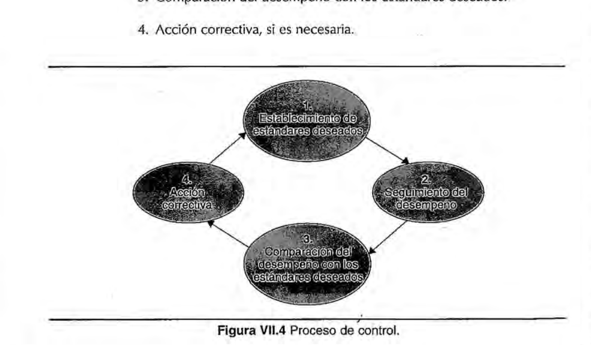

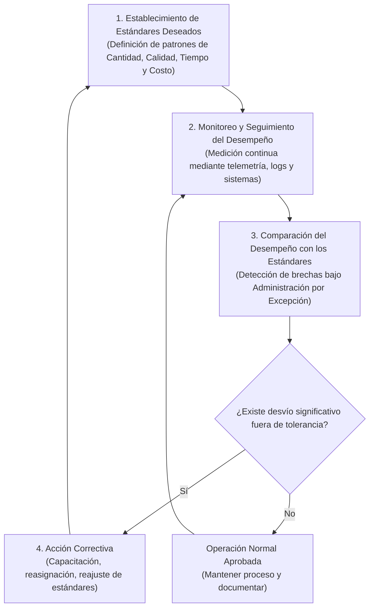

### Detalle de cada Etapa:
1. **Establecimiento de Estándares Deseados:** Definición formal previa de los patrones o normas de rendimiento aceptable para cada puesto o proceso. Un estándar representa el desempeño esperado. *Sin un estándar previo, el control es conceptualmente imposible*, ya que no existe un patrón objetivo de comparación.
2. **Monitoreo y Seguimiento del Desempeño:** Medición sistemática, continua y objetiva de lo que los colaboradores realmente ejecutan durante su jornada laboral (a través de telemetría de repositorios, logs de actividad, encuestas de satisfacción, informes de avance y observación directa).
3. **Comparación del Desempeño con los Estándares:** Evaluación analítica de la brecha o variación:
   $$\text{Variación} = \text{Desempeño Real} - \text{Estándar Esperado}$$
   Se contrasta el resultado obtenido con la norma establecida para calificar el nivel de eficacia alcanzado.
4. **Acción Correctiva:** Toma de decisiones ejecutivas orientadas a normalizar desvíos negativos (capacitaciones específicas, redistribución de cargas de trabajo, reasignación de herramientas tecnológicas) o bien a reajustar los propios estándares si resultaron excesivamente rígidos o desactualizados.

---

## 4. Principio de Administración por Excepción
Formulado originalmente por Frederick W. Taylor y desarrollado por Chiavenato, el **Principio de Excepción** establece que la gerencia y los líderes de equipo no deben desgastar su atención ni intervenir en aquellas operaciones rutinarias que se mantienen dentro de los límites de tolerancia normales fijados previamente. La intervención ejecutiva solo debe dispararse ante **variaciones excepcionales** (desvíos graves que superan los umbrales de tolerancia superior o inferior).

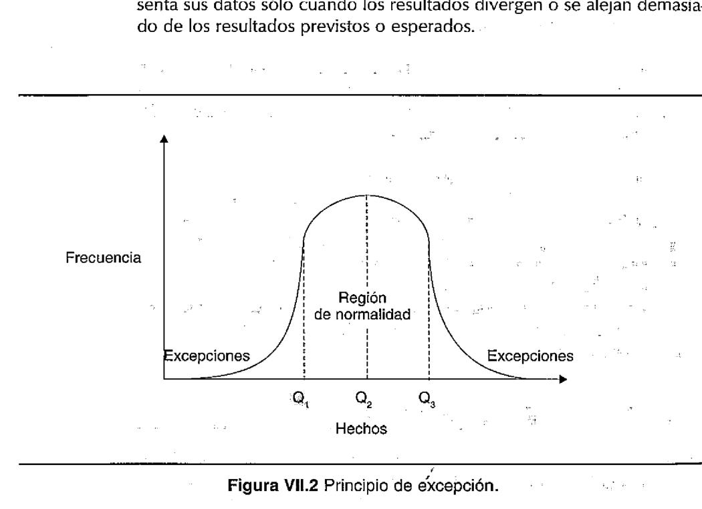

> **Ejemplo en Gestión de SI/TI:** Si un desarrollador resuelve habitualmente entre 5 y 7 User Stories por sprint (rango normal), el líder técnico no interviene. Si en un sprint resuelve solo 1 (desvío negativo excepcional) o resuelve 15 (desvío positivo excepcional por sobrecarga o mala estimación), se activa de inmediato el análisis y la acción correctiva.

---

## 5. Las Cuatro Dimensiones de los Estándares de Desempeño
Para que los estándares de evaluación en áreas de ingeniería de software y operaciones de TI no generen distorsiones o comportamientos perversos (por ejemplo, escribir código rápido pero lleno de fallos), deben formularse equilibrando cuatro dimensiones fundamentales:

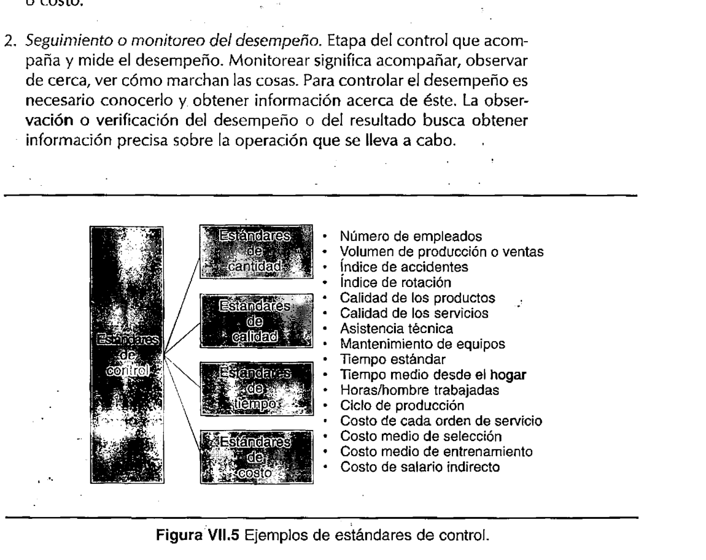

| Dimensión | Pregunta Clave | Qué Evalúa | Ejemplos Concretos en Áreas de SI/TI |
| :--- | :--- | :--- | :--- |
| **1. Cantidad** | ¿Cuánto? | Volumen numérico y masa de producción lograda en un lapso. | Resolver al menos 20 tickets N2 semanales; entregar 8 historias de usuario por sprint; procesar 50 órdenes de compra diarias. |
| **2. Calidad** | ¿Cómo de bien? | Exactitud, ausencia de defectos, conformidad con especificaciones y satisfacción. | Tasa de bugs en producción $\le 1.5\%$; cobertura de tests unitarios $\ge 80\%$; satisfacción del usuario en encuestas CSAT $\ge 92\%$. |
| **3. Tiempo** | ¿Cuándo / A qué ritmo? | Velocidad, puntualidad, tiempo de respuesta y cumplimiento de SLAs. | Tiempo de primera respuesta a incidentes críticos $\le 15 \text{ min}$; resolución de incidentes N1 $\le 2 \text{ h}$; entrega del release en la fecha pactada. |
| **4. Costo** | ¿A qué costo económico? | Eficiencia en el uso de recursos presupuestarios y horas-hombre. | Mantener el consumo en la nube (AWS/Azure) dentro del presupuesto mensual asignado; costo de reclutamiento por posición IT $\le \$1200 \text{ USD}$. |

---

## 6. Evaluación del Desempeño Humano
La **Evaluación del Desempeño** es la apreciación sistemática del valor que las conductas y resultados de una persona aportan a la organización. Constituye el instrumento operativo esencial que alimenta las etapas 2 (Monitoreo) y 3 (Comparación) del proceso de control de RRHH.

### Modelos de Responsabilidad por la Evaluación:
* **El Gerente de Línea:** Es el modelo clásico. El jefe directo evalúa a sus subordinados con la asesoría técnica del área de RRHH.
* **El Empleado y el Gerente (Gestión Participativa):** El colaborador propone sus objetivos y autoevaluación, debatiéndola con el gerente (base de la EPPO).
* **El Equipo de Trabajo:** Los miembros del equipo ágil (Scrum Team) se evalúan mutuamente con base en los compromisos asumidos.
* **Comité de Evaluación:** Grupo interdisciplinario de gerentes y especialistas que analizan los informes de desempeño para homogeneizar criterios.
* **Órgano de Gestión de Personas (RRHH centralizado):** Modelo burocrático y en desuso donde RRHH califica desde el exterior.

---

## 7. Métodos Tradicionales de Evaluación del Desempeño

### A. Método de las Escalas Gráficas (Graphic Rating Scales)
Es el método más difundido y utilizado históricamente por su simplicidad. Emplea un formulario de doble entrada: en las filas se listan los **factores de evaluación** (dimensiones conductuales y laborales como *Producción, Calidad, Conocimiento del cargo, Cooperación, Creatividad*) y en las columnas se disponen los **grados de variación del desempeño** (discontinuos, semicontinuos o continuos: *Óptimo, Bueno, Regular, Tolerable, Pobre*).

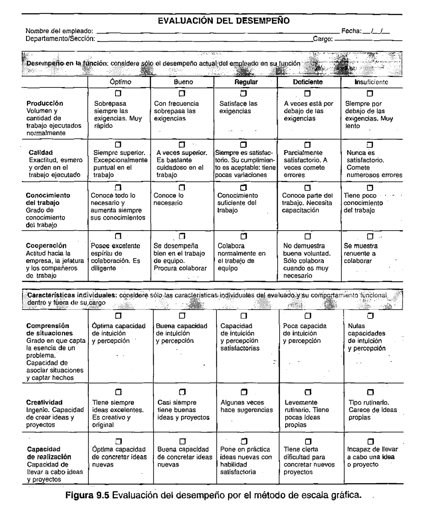

* **Ventajas:** Formulario de fácil comprensión, aplicación sumamente rápida y bajo costo de implementación.
* **Desventajas:** Alta vulnerabilidad a sesgos subjetivos (Efecto Halo, Tendencia Central), rigidez estandarizada que no contempla peculiaridades del puesto y nula retroalimentación profunda para el colaborador.

### B. Método de Elección Forzada (Forced Choice)
Diseñado durante la Segunda Guerra Mundial por el ejército estadounidense para eliminar la subjetividad del evaluador. El formulario contiene bloques o conjuntos de frases descriptivas (generalmente 2 o 4 frases por bloque). El evaluador está obligado a marcar exclusivamente la frase que **más se aplica (+)** y la que **menos se aplica (-)** al comportamiento del empleado.

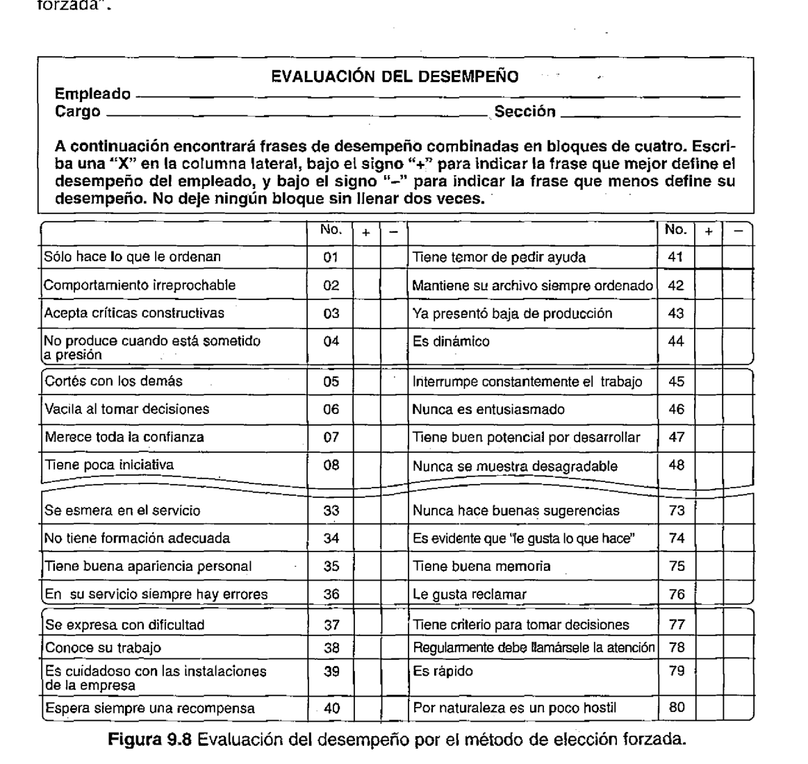

* **Ventajas:** Elimina radicalmente el favoritismo, la benevolencia y la subjetividad del evaluador, pues este desconoce el puntaje estadístico de cada frase.
* **Desventajas:** Su elaboración técnica es muy compleja y costosa; no proporciona feedback cualitativo al empleado ni permite planificar capacitaciones individualizadas.

### C. Método de Incidentes Críticos
Se basa en el principio de que en los extremos del desempeño residen los comportamientos más reveladores. El evaluador mantiene una bitácora continua donde registra únicamente los **éxitos excepcionales** (conductas altamente eficaces que agregan gran valor) y las **fallas graves** (conductas ineficaces que causan perjuicio).

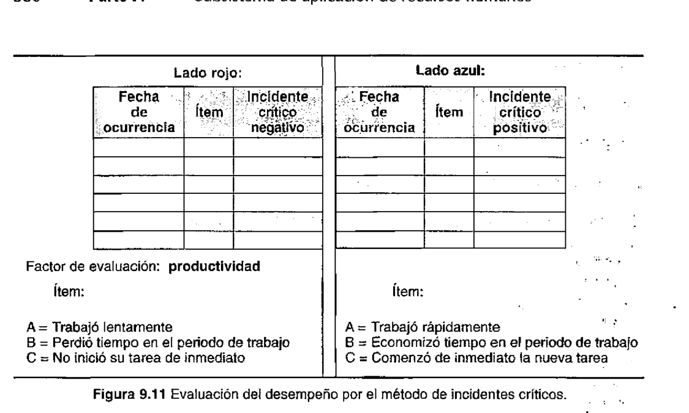

### D. Método de Investigación de Campo
Un especialista en evaluación de RRHH visita el área de trabajo y mantiene entrevistas directas con cada gerente de línea. El proceso sigue 4 fases estructuradas: *1) Evaluación inicial del desempeño, 2) Análisis complementario, 3) Planeamiento de acciones conjuntas (capacitación, ascenso), y 4) Seguimiento de resultados*. Es uno de los métodos tradicionales más completos pero de mayor costo operativo.

### E. Método de Comparación por Pares
Compara a los empleados del mismo nivel de a dos por vez respecto a un factor específico (por ejemplo, productividad), marcando con una cruz a aquel que presente un desempeño superior. Genera un ranking jerárquico pero resulta inviable para equipos numerosos ($N > 15$).

---

## 8. Métodos Modernos de Evaluación

### A. Evaluación de 360 Grados (Feedback Circular)
Es un enfoque integral donde el colaborador es evaluado de manera anónima y simultánea por todos los actores que interactúan con su trabajo: **1) Jefe directo, 2) Pares y compañeros de equipo, 3) Subordinados directos, 4) Clientes internos y externos, y 5) Autoevaluación**.

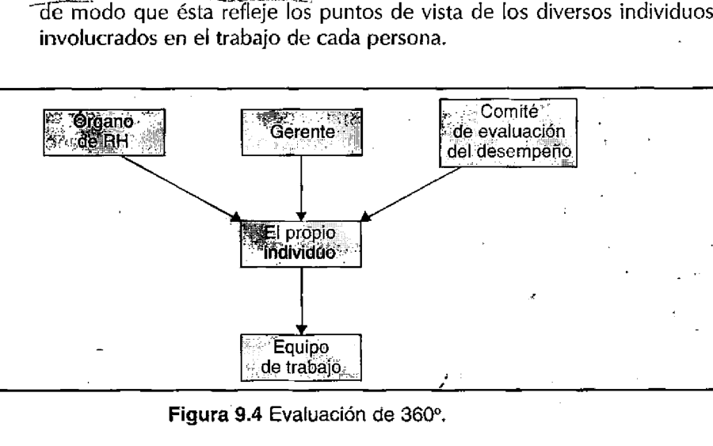

* **Ventajas:** Visión panorámica y multidimensional del desempeño; reduce el sesgo unipersonal del jefe; fomenta el trabajo en equipo y la mejora continua.
* **Desventajas:** Complejidad organizativa; requiere madurez cultural en la empresa para evitar represalias o calificaciones complacientes.

### B. Evaluación Participativa por Objetivos (EPPO / OKRs)
El evaluador y el colaborador definen de común acuerdo los objetivos trimestrales o anuales, los recursos necesarios y los indicadores clave de resultado (Key Results). La evaluación consiste en medir el grado de consecución real respecto a las metas pactadas.

---

## 9. Sesgos Cognitivos y Distorsiones de Medición del Evaluador

| Sesgo Cognitivo | Mecanismo Psicológico | Impacto en la Medición | Ejemplo en SI/TI |
| :--- | :--- | :--- | :--- |
| **Efecto Halo (Halo Effect)** | Generalizar una cualidad positiva sobresaliente a todos los demás aspectos del desempeño. | Calificar excelente en todo el formulario a alguien por ser simpático o llegar temprano. | Un programador es muy carismático en las reuniones, y su jefe le califica erróneamente con nota máxima en calidad técnica de código (aunque su código falle). |
| **Efecto Horns (Halo Negativo)** | Generalizar un rasgo desfavorable o antipático a todas las dimensiones de la evaluación. | Subestimar y castigar injustamente todas las competencias de un empleado. | Un ingeniero DevOps tuvo un error en un deploy hace 6 meses; el jefe le califica bajo en iniciativa, trabajo en equipo y puntualidad. |
| **Tendencia Central** | Miedo a calificar en los extremos (altas o bajas calificaciones), ubicando a todos en el promedio (nota media). | Invisibiliza a los talentos sobresalientes y no penaliza a los empleados de bajo rendimiento. | Un líder técnico califica a todos sus desarrolladores con 7/10 en el formulario para evitar conflictos en el equipo. |
| **Benevolencia / Severidad** | Laxitud excesiva o rigor inflexible del evaluador. | Distorsiona la escala salarial y de ascensos; genera inequidad interna. | Un gerente blando califica a todos con 10/10 (benevolencia); otro gerente califica con 4/10 al mejor del área porque "la perfección no existe" (severidad). |
| **Error de Recencia** | Ponderar en exceso los acontecimientos de las últimas 2 o 3 semanas anteriores a la evaluación, olvidando el resto del año. | No refleja el desempeño anual real ni la constancia de trabajo. | Un empleado que trabajó excelente todo el año comete un bug la semana previa a la evaluación y recibe una mala calificación anual. |
| **Semejanza (Similar-to-me)** | Favorecer a quienes comparten ideas, gustos, formación universitaria o estilos similares al evaluador. | Discrimina a perfiles diversos y favorece el conformismo. | Un jefe egresado de UTN califica mejor a los graduados de su misma facultad que a graduados de otras universidades. |

---

## 10. La Entrevista de Evaluación y Retroalimentación
La evaluación del desempeño carece de valor si sus resultados no se comunican al evaluado. La **Entrevista de Feedback** debe regirse por los siguientes principios:
* Enfocarse en **comportamientos y hechos observables**, jamás en la personalidad del colaborador.
* Mantener una comunicación bidireccional basada en la escucha activa y la empatía.
* Comenzar destacando los logros y fortalezas alcanzadas antes de abordar las áreas de mejora.
* Finalizar con un **Plan de Acción y Desarrollo** consensuado con fechas y compromisos mutuos de capacitación y seguimiento.

---

## 11. Bases de Datos y Sistemas de Información de RRHH (SIG/HRIS)
Chiavenato establece una clara distinción conceptual entre dato e información:
* **Dato:** Registro elemental o hecho aislado sin procesar (ejemplo: "Juan ingresó a las 09:12").
* **Información:** Conjunto de datos procesados, contextualizados y analizados que reducen la incertidumbre y sustentan la toma de decisiones (ejemplo: "La tasa de ausentismo del equipo de frontend se incrementó un $14\%$ tras el cambio de líder").

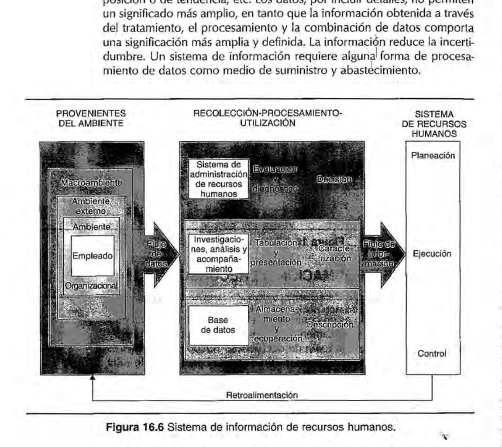

El Sistema de Información de RRHH centraliza e integra los datos suministrados por los restantes subsistemas organizacionales:

| Subsistema de Origen | Información que aporta al SIG de Control |
| :--- | :--- |
| **Provisión (Admisión)** | Fuentes de reclutamiento, candidatos postulados, perfiles de competencias, costo de adquisición por contratación. |
| **Aplicación (Organización)** | Descripción de cargos, organigrama, planes de trabajo y resultados históricos de las Evaluaciones de Desempeño. |
| **Mantenimiento (Retención)** | Escala salarial, beneficios, ausentismo, rotación de personal (*turnover*), accidentes laborales y clima organizacional. |
| **Desarrollo (Capacitación)** | Horas de capacitación acumuladas por empleado, certificaciones obtenidas y retorno de inversión del aprendizaje (ROI). |

---

## 12. Auditoría de Recursos Humanos
La **Auditoría de RRHH** es un examen analítico, sistemático y preventivo de todas las políticas, procedimientos y prácticas de gestión de personas dentro de la organización. Su propósito es verificar si el sistema está alineado con la estrategia del negocio y cumple estrictamente con el marco legal vigente.

### Auditoría de la función de personal de los Gerentes de Línea
Los gerentes de línea (líderes técnicos, gerentes de desarrollo) tienen responsabilidad ejecutiva sobre su personal. La auditoría verifica si aplican correctamente las evaluaciones en tiempo y forma, si asignan tareas con equidad, si motivan a sus subordinados y si cumplen los convenios laborales.

---
---

# PARTE II: SUBSISTEMA DE SEGUIMIENTO DE SOFTWARE Y HARDWARE (SI/TI)

## 1. Fundamentos y Objetivos del Seguimiento de SI/TI
En el campo de la ingeniería de sistemas y la administración de centros de cómputo (Xavier Molero et al., 2004; Ramón Puigjaner, 1995), el **Seguimiento de Software y Hardware** persigue 4 objetivos críticos:
1. **Planificación de Capacidad (Capacity Planning):** Prever cuándo la infraestructura actual quedará saturada por el crecimiento de la demanda de los usuarios y determinar con precisión qué componentes adquirir y cuándo.
2. **Detección y Eliminación de Cuellos de Botella (Bottleneck Detection):** Identificar qué recurso específico (CPU, RAM, Disco/I/O, Red) restringe el rendimiento general del sistema.
3. **Optimización y Sintonía Fina (System Tuning):** Modificar parámetros de configuración del sistema operativo, motores de base de datos o balanceadores de carga para maximizar la productividad sin invertir en nuevo hardware.
4. **Garantía de Acuerdos de Nivel de Servicio (SLAs):** Monitorear que los tiempos de respuesta y la disponibilidad pactados contractualmente con los clientes se cumplan de forma continua.

---

## 2. Las Tres Familias de Técnicas de Evaluación
La cátedra clasifica metodológicamente la evaluación del rendimiento en 3 grandes familias:

| Técnica | Fundamento Metodológico | Costo y Tiempo | Exactitud | Fase de Aplicación Óptima |
| :--- | :--- | :--- | :--- | :--- |
| **1. Medición Directa (Monitorización & Benchmarking)** | Observación y toma de muestras sobre el **sistema real** en producción o laboratorios de prueba ejecutando cargas de trabajo reales o bancos estandarizados. | Variable (Bajo si se usan monitores SW; Alto si requiere laboratorio físico). | **Máxima** (mide la realidad exacta del hardware y software). | Sistemas ya existentes en operación, diagnóstico de fallas y pruebas de aceptación de servidores. |
| **2. Modelado Analítico (Análisis Operacional)** | Formulación de **ecuaciones matemáticas y teoría de redes de colas** basadas en relaciones operacionales comprobables sin supuestos probabilísticos restrictivos. | **Mínimo** (se resuelve rápidamente con fórmulas algebraicas y hojas de cálculo). | Alta para orden de magnitud y límites asintóticos; predictiva. | Diseño preliminar de arquitecturas, análisis de capacidad y dimensionamiento previo de servidores. |
| **3. Modelado por Simulación** | Construcción de un **programa informático** que reproduce el comportamiento dinámico del sistema a lo largo del tiempo mediante eventos discretos. | **Alto** (gran costo de desarrollo de software y elevado tiempo de cómputo). | Muy alta si el modelo está correctamente calibrado. | Arquitecturas sumamente complejas que no pueden resolverse analíticamente con fórmulas cerradas. |

---

## 3. Análisis Operacional: Balance y Estaciones de Servicio
El **Análisis Operacional** (desarrollado por Buzen, Denning y formalizado por Molero et al.) modela sistemas informáticos a partir de cantidades medibles en un intervalo de tiempo $T$.

> **Supuesto Fundamental de Balance Operacional:** En un período de observación $T$ suficientemente largo, el número de peticiones llegadas al sistema $A$ es aproximadamente igual al número de peticiones completadas $C$ ($A \approx C$). En consecuencia, la tasa de llegadas $\lambda$ es igual a la productividad $X$ ($\lambda = X$).

### Concepto de Estación de Servicio
Una estación de servicio es una abstracción que modela un recurso del sistema (como un núcleo de CPU o un disco). Consta de un mecanismo de espera (cola) y uno o varios servidores de procesamiento:

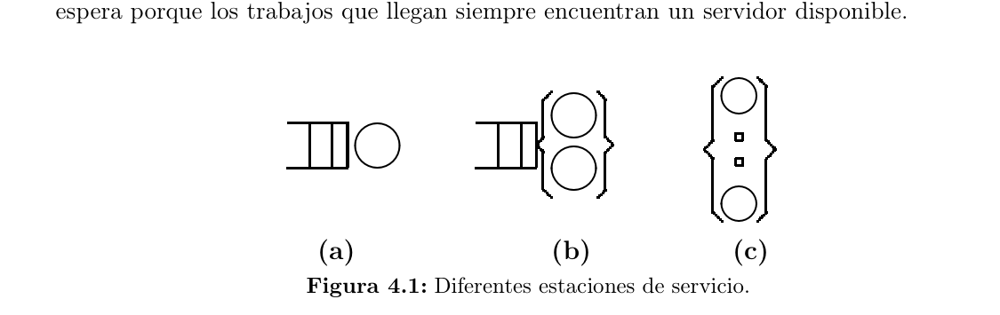

* **Estación de Servidor Único ($m = 1$):** Las peticiones hacen cola y son atendidas por un único procesador o disco.
* **Estación Multicanal ($m > 1$):** Una sola cola compartida alimenta a múltiples servidores idénticos (procesadores multinúcleo).
* **Estación de Retardo ($m = \infty$):** Cada petición recibe un servidor inmediato sin hacer cola. Se utiliza para modelar el tiempo de reflexión o lectura del usuario (**Think Time** $Z$).

---

## 4. Variables Operacionales Básicas y Deducidas

| Tipo | Variable | Símbolo | Fórmula Formal | Unidad Típica | Significado Operacional |
| :--- | :--- | :---: | :---: | :---: | :--- |
| **Básicas** | Tiempo de Observación | $T$ | Directa | segundos / min | Duración total del período de monitoreo. |
| | Peticiones Llegadas | $A$ | Directa | peticiones | Total de solicitudes que ingresaron al sistema en $T$. |
| | Peticiones Completadas | $C$ | Directa | peticiones | Total de solicitudes procesadas y despachadas con éxito en $T$. |
| | Tiempo Ocupado | $B$ | Directa | segundos | Tiempo acumulado durante el cual el recurso estuvo trabajando ($B \le T$). |
| **Deducidas** | Tasa de Llegadas | $\lambda$ | $\lambda = \frac{A}{T}$ | pet / seg | Frecuencia media de ingreso de nuevas peticiones. |
| | Productividad (Throughput) | $X$ | $X = \frac{C}{T}$ | pet / seg | Ritmo real de peticiones procesadas por unidad de tiempo. |
| | Utilización del Recurso | $U$ | $U = \frac{B}{T}$ | $\%$ o $[0, 1]$ | Fracción de tiempo que el recurso estuvo ocupado trabajando. |
| | Tiempo Medio de Servicio | $S$ | $S = \frac{B}{C}$ | seg / pet | Tiempo de procesamiento puro que el recurso dedica a una petición. |
| | Tiempo Medio de Respuesta | $R$ | $R = \frac{W}{C}$ | seg / pet | Tiempo total que la petición pasa en el sistema ($\text{Espera en cola} + \text{Servicio}$). |
| | Número Medio de Trabajos | $N$ o $Q$ | $N = \frac{W}{T}$ | peticiones | Cantidad promedio de peticiones presentes en el sistema o en la cola. |

---

## 5. Demostración Formal de las Leyes Operacionales

### A. Ley de la Utilización
$$U = X \cdot S = \frac{B}{T}$$
**Demostración:** Por definición, $X = \frac{C}{T}$ y $S = \frac{B}{C}$. Multiplicando ambas expresiones:
$$X \cdot S = \left(\frac{C}{T}\right) \cdot \left(\frac{B}{C}\right) = \frac{B}{T} = U \quad \blacksquare$$

### B. Ley de Little
$$N = X \cdot R$$
El número medio de clientes o peticiones en el sistema ($N$) es igual a la productividad del sistema ($X$) multiplicada por el tiempo medio de respuesta ($R$).  
**Demostración:** Sea $W$ el área total de permanencia acumulada. $N = \frac{W}{T}$ y $R = \frac{W}{C}$. Sustituyendo $W = C \cdot R$:
$$N = \frac{C \cdot R}{T} = \left(\frac{C}{T}\right) \cdot R = X \cdot R \quad \blacksquare$$

### C. Ley de Flujo Forzado
$$X_k = V_k \cdot X_0$$
Donde $X_k$ es la productividad del dispositivo $k$, $X_0$ es la productividad global del sistema, y $V_k$ es el **número medio de visitas** que cada petición realiza al dispositivo $k$ ($V_k = \frac{C_k}{C_0}$).

### D. Demanda de Servicio del Dispositivo ($D_k$)
$$D_k = V_k \cdot S_k = \frac{U_k}{X_0}$$
Representa el tiempo total acumulado de servicio que una petición exige al dispositivo $k$ a lo largo de todas sus visitas.

---

## 6. Ley del Tiempo de Respuesta Interactivo (Ley de Bruni)
En un sistema interactivo cerrado con $N$ usuarios concurrentes (por ejemplo, el Chatbot Bruni o un portal Web), cada usuario opera en un ciclo continuo: pasa un tiempo de reflexión y lectura $Z$ (*Think Time*) y envía una consulta al backend, esperando un tiempo de respuesta $R$ antes de volver a pensar.

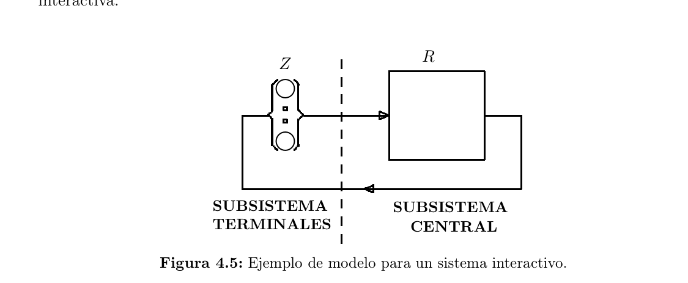

$$R = \frac{N}{X_0} - Z \iff X_0 = \frac{N}{R + Z}$$

**Demostración formal:**  
El tiempo medio que tarda un usuario en completar un ciclo interactivo completo es $(R + Z)$. Aplicando la Ley de Little al conjunto total de los $N$ usuarios:
$$N = X_0 \cdot (R + Z)$$
Despejando $R$:
$$\frac{N}{X_0} = R + Z \implies R = \frac{N}{X_0} - Z \quad \blacksquare$$

---

## 7. Cuello de Botella ($D_{\max}$) y Límites Asintóticos de Rendimiento
El **cuello de botella (Bottleneck)** de un sistema informático es el dispositivo o recurso que tiene la **mayor demanda de servicio acumulada**:
$$D_{\max} = \max_k \{ D_k \}$$

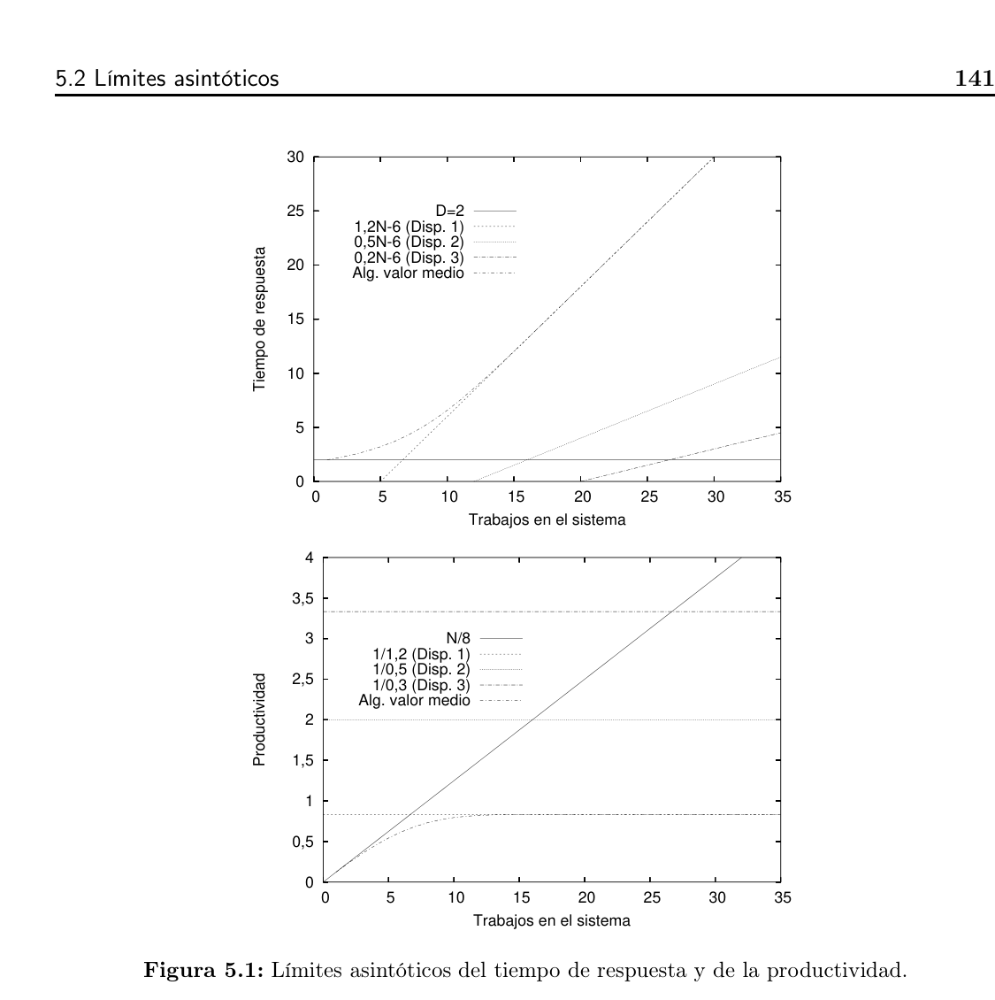

### Límites Asintóticos Fundamentales:
* **Límite Asintótico de Productividad Máxima:** La productividad global de todo el sistema jamás puede superar la capacidad máxima de procesamiento de su cuello de botella:
  $$X_0 \le \frac{1}{D_{\max}}$$
* **Límite de Tiempo de Respuesta a Baja Carga ($N = 1$):** Cuando no hay concurrencia ni esperas en cola, el tiempo de respuesta mínimo es la suma de todas las demandas de servicio del sistema:
  $$R \ge D = \sum_k D_k$$
* **Límite de Tiempo de Respuesta a Alta Carga ($N \to \infty$):** Con muchos usuarios, el cuello de botella trabaja al $100\%$ ($X_0 \to \frac{1}{D_{\max}}$), por lo que el tiempo de respuesta crece linealmente dominado por $D_{\max}$:
  $$R(N) \ge N \cdot D_{\max} - Z$$

---

## 8. Punto de Saturación ($N^*$) y Procedimiento de Mitigación
El **punto de saturación $N^*$** representa el número óptimo de usuarios concurrentes a partir del cual el sistema comienza a encolar peticiones de manera inevitable y el rendimiento se degrada:
$$N^* = \frac{D + Z}{D_{\max}} = \frac{\sum D_k + Z}{D_{\max}}$$

### Procedimiento Metódico para Mitigar Cuellos de Botella:
1. **Medición de Demandas:** Medir las demandas de servicio de todos los dispositivos ($D_{\text{CPU}}, D_{\text{Disco}}, D_{\text{Red}}, D_{\text{RAM}}$) para identificar formalmente cuál coincide con $D_{\max}$.
2. **Intervención Quirúrgica en el Cuello de Botella:** Aplicar mejoras técnicas exclusivamente en el componente crítico (upgrade de procesador, almacenamiento NVMe, indexación SQL, caching en Redis, aumento de ancho de banda).
3. **Desplazamiento Asintótico y Reevaluación:** Al reducir la demanda del recurso crítico, las asíntotas se desplazan positivamente, pero el cuello de botella se traslada hacia el segundo recurso más demandado. El proceso debe repetirse iterativamente.

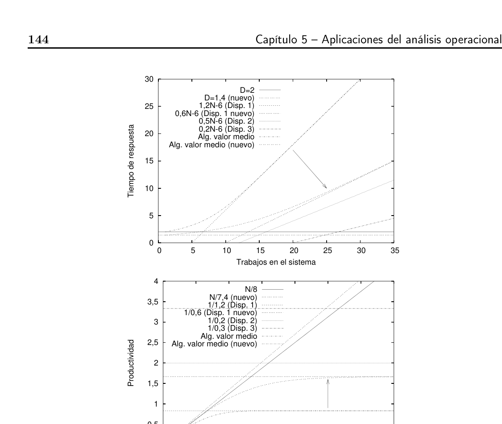

---

## 9. Ley de Amdahl: Formulación, Demostración y Límite Teórico
La **Ley de Gene Amdahl (1967)** establece el límite teórico de la ganancia de velocidad (*Speedup* o Aceleración Global $S$) que puede obtenerse al optimizar una fracción específica de un sistema mediante un factor de mejora $k$.

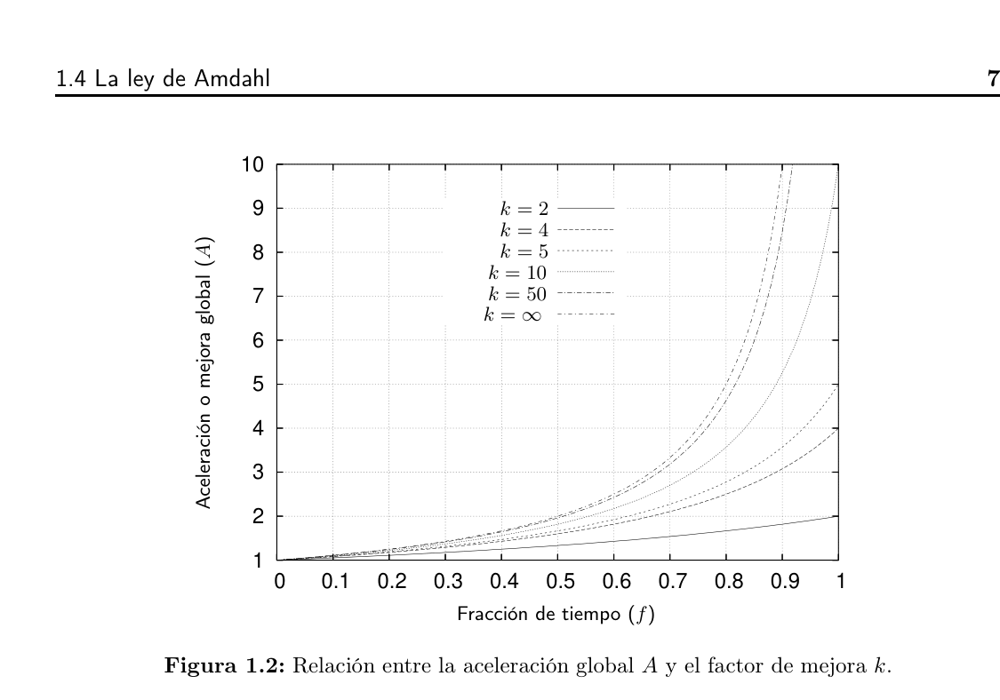

$$S = \frac{T_{\text{original}}}{T_{\text{mejorado}}} = \frac{1}{(1 - f) + \frac{f}{k}}$$

Donde:
* $f$: Fracción del tiempo total de ejecución que resulta afectada por la mejora ($0 \le f \le 1$).
* $(1 - f)$: Fracción no modificable o estrictamente secuencial del sistema.
* $k$: Factor de aceleración o mejora aplicada exclusivamente a la fracción $f$.

### Demostración Formal:
Sea $T_o$ el tiempo de ejecución original. El nuevo tiempo de ejecución tras la optimización $T_m$ es la suma de la parte inalterable más la parte acelerada:
$$T_m = (1 - f) \cdot T_o + \frac{f \cdot T_o}{k} = T_o \cdot \left[ (1 - f) + \frac{f}{k} \right]$$
Calculando el factor de aceleración global $S = \frac{T_o}{T_m}$:
$$S = \frac{T_o}{T_o \cdot \left[ (1 - f) + \frac{f}{k} \right]} = \frac{1}{(1 - f) + \frac{f}{k}} \quad \blacksquare$$

### Límite Asintótico Teórico (Mejora Infinita $k \to \infty$):
$$S_{\max} = \lim_{k \to \infty} \left[ \frac{1}{(1 - f) + \frac{f}{k}} \right] = \frac{1}{1 - f}$$

> **Regla de Decisión para Ingenieros:** La aceleración global está estrictamente acotada por la fracción que *no* se optimiza $(1 - f)$. Por ejemplo, si en una aplicación el $40\%$ del código es puramente secuencial ($1-f = 0.4$), aunque compremos un supercomputador con infinitos núcleos para el $60\%$ restante ($k \to \infty$), la aceleración máxima jamás superará $S_{\max} = \frac{1}{0.4} = 2.5\times$. Por ello, la inversión debe priorizar siempre los cuellos de botella con mayor fracción $f$.

---

## 10. Monitores de Sistemas Informáticos
Un **Monitor** es una herramienta técnica diseñada para observar, medir y registrar el comportamiento dinámico de un sistema informático mientras este opera.

### Requisitos de Calidad de un Monitor:
1. **Interferencia (Grado de Intrusión):** Es la sobrecarga de consumo de CPU, RAM e I/O que el propio monitor genera sobre el sistema evaluado. Un monitor ideal debe tener mínima o nula interferencia.
2. **Resolución Temporal:** Es el intervalo mínimo de tiempo entre dos eventos consecutivos que el monitor es capaz de discriminar y registrar.
3. **Dominio:** Conjunto y naturaleza de los eventos que el monitor puede observar (eventos físicos del bus vs. eventos lógicos del sistema operativo).

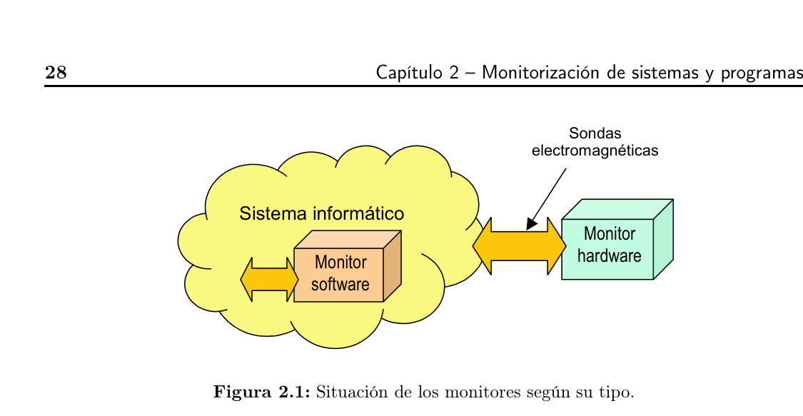

### Esquema Estructural de los 4 Bloques de un Monitor:
1. **Sensor / Detector:** Componente que detecta la ocurrencia del evento que se desea medir.
2. **Mecanismo de Control / Recolector:** Módulo que decide si el evento detectado debe procesarse, calcula contadores y extrae las muestras.
3. **Almacenamiento Intermedio (Buffer):** Memoria temporal donde se encolan las muestras recolectadas para evitar saturar el sistema de I/O.
4. **Visualizador / Salida:** Módulo de presentación que analiza los registros y genera gráficos, tablas de estadísticas o alertas.

| Característica | Monitores Software (`sar`, `vmstat`, `top`) | Monitores Hardware (Sondas Físicas) | Monitores Híbridos |
| :--- | :--- | :--- | :--- |
| **Dominio** | Eventos lógicos del SO (llamadas al sistema, cambios de contexto, colas de disco, memoria swap). | Eventos físicos del hardware (ciclos de reloj, voltajes, señales de bus PCIe, microarquitectura). | Eventos mixtos físico-lógicos (contadores de rendimiento de CPU en el chip). |
| **Resolución** | Milisegundos / Microsegundos. | **Nanosegundos** (ciclos de reloj). | Nanosegundos a microsegundos. |
| **Interferencia** | **Presente** (consume ciclos de CPU y memoria del sistema anfitrión). | **Nula ($0\%$)** (no consume ningún recurso del sistema monitorizado). | Despreciable o casi nula. |
| **Costo y Flexibilidad** | Gratuitos, integrados en Linux/Unix, altamente configurables. | Extremadamente costosos, requieren conexión de sondas físicas especializadas. | Medio-alto (requiere soporte específico del microprocesador). |

---

## 11. Monitoreo por Muestreo vs. Eventos y Telemetría Linux

### Modos de Activación de Monitores:
* **Muestreo (Sampling / Polling):** El monitor inspecciona el estado del sistema a intervalos fijos de tiempo $\Delta t$ (por ejemplo, cada 1 segundo). Consume recursos constantes pero puede perder picos breves entre muestras.
* **Activados por Eventos (Event-driven):** El monitor se ejecuta cada vez que ocurre un evento específico (por ejemplo, cada interrupción de disco o fallo de página). Brinda precisión absoluta pero genera alta interferencia bajo cargas masivas.

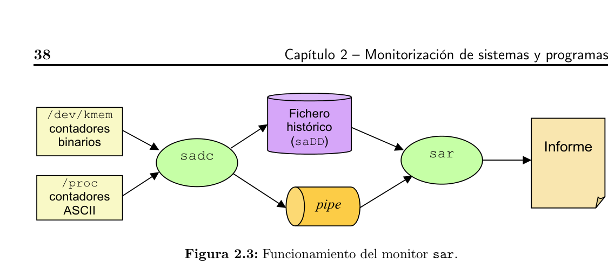

### Herramientas de Monitoreo Estándar en Linux:
* `top` / `htop`: Monitor interactivo de CPU, memoria y procesos en tiempo real.
* `vmstat`: Informa sobre procesos en cola de CPU (`r`, `b`), memoria virtual activa/inactiva, tasa de swapping (`si`, `so`) e interrupciones.
* `iostat`: Monitorea la tasa de transferencia y utilización ($U\%$) de los discos de almacenamiento.
* `sar` (System Activity Reporter): El monitor histórico más potente de Linux. Se divide en el recolector en segundo plano (`sadc`) que guarda las métricas en `/var/log/sa/saXX` y el visor analítico (`sar`).

---

## 12. Benchmarking de Sistemas Informáticos
Es indispensable distinguir dos términos que suelen confundirse en los exámenes:
* **Benchmark (Banco de Pruebas):** Programa o conjunto estandarizado de programas diseñado para medir de forma repetible el rendimiento de un sistema informático o componente bajo condiciones controladas.
* **Benchmarking:** Proceso continuo y metódico de evaluar y comparar el rendimiento de nuestros sistemas contra las mejores prácticas del mercado o contra arquitecturas alternativas para fundamentar decisiones de inversión.

### Tipos de Benchmarks:
* **Micro-benchmarks:** Evalúan un componente aislado a nivel básico (ejemplo: velocidad de copia de bloques de RAM en MB/s con SysBench).
* **Benchmarks Sintéticos:** Programas artificiales con bucles matemáticos (Whetstone para coma flotante, Dhrystone para enteros).
* **Benchmarks de Aplicación Real:** Suites estándar del consorcio SPEC (CPU, Java) y TPC (TPC-C, TPC-E para transacciones de bases de datos relacionales).

### Caso Práctico SysBench: Análisis del Ancho de Banda de Memoria RAM
En el Trabajo Práctico N° 5.2 de la cátedra se analiza la curva de SysBench para transferencia de memoria en función del tamaño de bloque (Block Size):

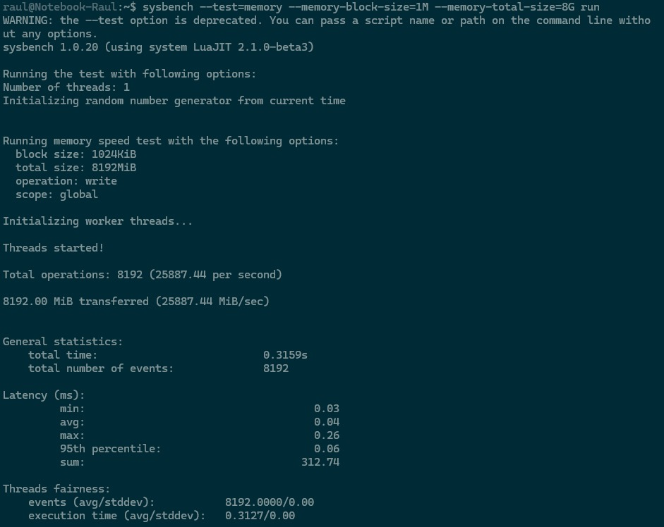

* **Zona 1 (Bloques pequeños $\le 16 \text{ KB}$):** El rendimiento es bajo debido a la sobrecarga (*overhead*) de las llamadas al sistema e invocaciones de funciones por cada pequeño fragmento transferido.
* **Zona 2 (Bloques medianos $32 \text{ KB} - 512 \text{ KB}$):** La tasa de transferencia sube exponencialmente y alcanza un pico altísimo gracias a que los bloques caben íntegramente en las **memorias caché del procesador (L1, L2 y L3)**.
* **Zona 3 (Bloques grandes $\ge 1 \text{ MB}$):** La tasa de transferencia desciende y se estabiliza en una **meseta plana horizontal**. Esta meseta representa el **límite físico real del ancho de banda del bus de memoria RAM (DRAM Bus Bandwidth)**.
